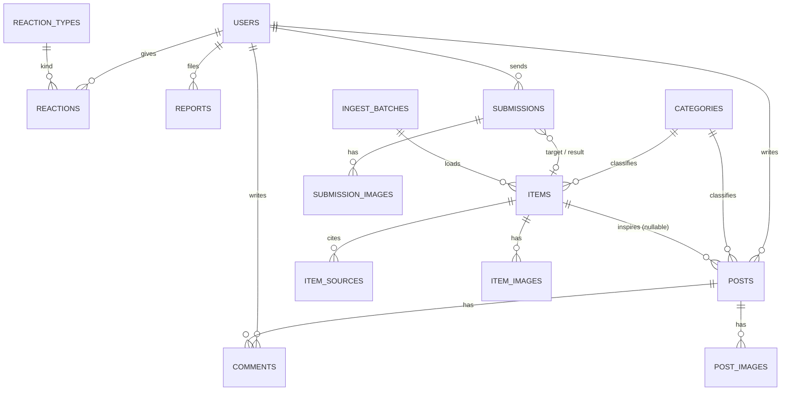
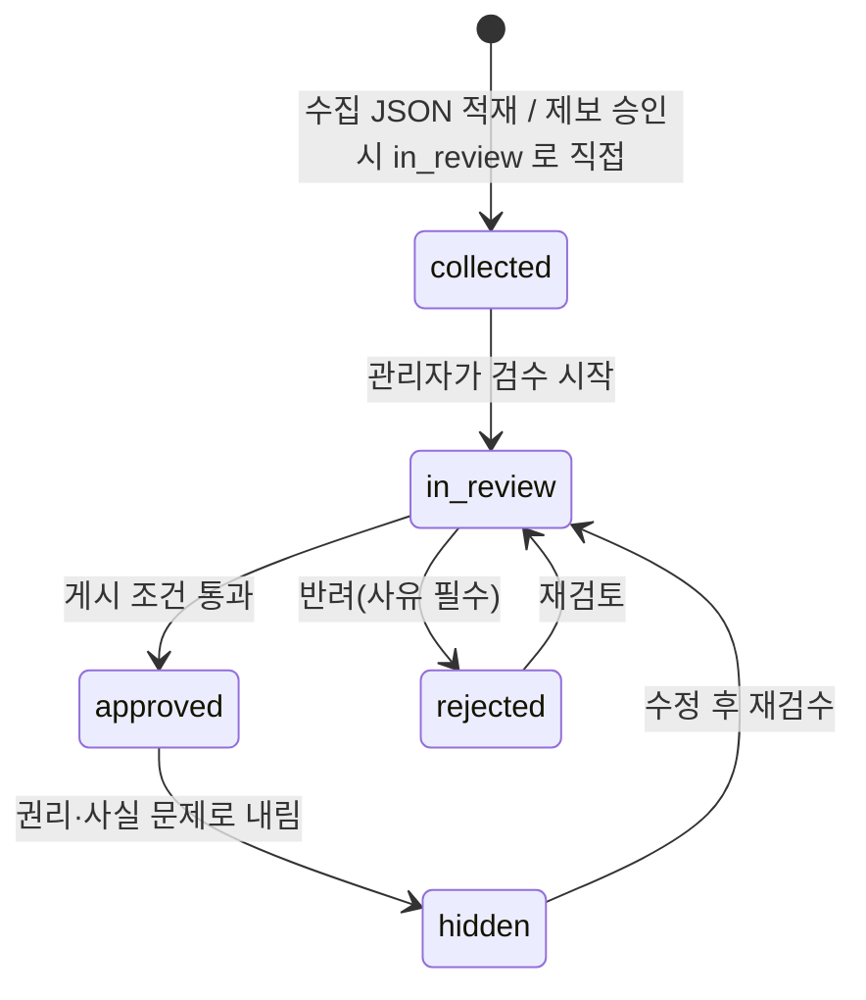

# 추억 타임머신 — 데이터·API 설계 (D1 스키마 · 쿼리 · 엔드포인트 · 관리자 · 수집 적재)

> 버전: v0.1 초안 · 2026-11-17
> 기준 문서: `추억타임머신_통합기획설계서.md` (v4.0) §5 콘텐츠 · §5.3-4 수집 단계 · §5.5 콘텐츠 기준 · §6 커뮤니티 · §10 기술
> 상태: **설계 초안. 구현 전.** 이 문서의 SQL은 텍스트 제안일 뿐이며 **어떤 DB에도 실행하지 않았다.** 마이그레이션 파일도 만들지 않았다.
> 표기 — [확정] 기준 문서에서 사용자가 확정한 것 · [문서] 기준 문서 내용 · [제안] 이 문서가 추천하는 설계 · [미정] 결정 필요 · [미확인] 확인 못 한 사실
> 기술 기준: Cloudflare Pages + Pages Functions + D1 + R2 + KV (기준 문서 §10.2, ADR 상태 Proposed — 프로토타입 성능 확인 후 확정)

---

## 0. 요약과 확정/미정 한눈에

**확정 사항 (기준 문서 §13 · 사용자 결정)**
- 로그인은 카카오·구글만 (Q8-1). 출생연도는 선택 입력.
- 커뮤니티 글은 연·월에 귀속하되 월을 모르면 연도만, 그 달 지표면과 통합 피드에 동시 노출 (Q3).
- 댓글은 일반 댓글 + 반응(이모지·삐삐 암호) + 신고 (Q7-1).
- 사용자 제보는 바로 반영하지 않고 관리자가 나중에 검토해 추가 (Q5-1).
- 아이템에 출처·권리 상태·시기 정확도(정확한 월 / 연도만 / 대략)·검토 상태·AI 여부를 기록 (§5.5). 카테고리 7종(§5.1).
- 신고 3건 누적 시 글 자동 비공개 (AC-07), 반응은 클릭하면 +1, 다시 클릭하면 취소 (AC-05).
- 1950~70년대는 1차에서 텍스트만 수집(이미지 만들지 않음), 1980년대 이후는 수집 가능한 사이트 조사 후 수집 (§5.3-4).

**이 문서가 새로 제안하는 핵심 (모두 [제안], 표 `§9 결정 대기`에서 승인 필요)**
1. 월 불변식: `month`가 있으면 정확도는 반드시 `month`, 없으면 `NULL`. 정확도가 `year`/`approx`인 항목은 월을 저장하지 않는다 (§5.5 "억지로 특정 월에 넣지 않는다"를 DB 제약으로 강제).
2. ID는 ULID(시간순 정렬 가능) → 피드 페이지 이동을 `id < 커서` 하나로 처리.
3. 반응·댓글·신고 카운터는 트리거 없이 같은 배치 안에서 재계산(멱등). 3건 자동 비공개도 같은 방식.
4. 수집 JSON은 항상 `review_status='collected'`(비공개)로 들어가며 자동 승인하지 않는다.
5. 수집 파일 3개를 열어 본 결과: ① 1960년대 파일이 작업 중 **한글 키 규격에서 표준 규격으로 다시 쓰였고**(내가 처음 열었을 때와 달라짐) ② 그 파일 끝에 **아이템이 아닌 `{"note": …}` 행**이 섞여 있으며 ③ `음악·라디오·영화·TV`처럼 **아직 매핑표에 없는 카테고리 표기**가 나온다 — 적재기는 이런 변동을 견뎌야 한다(§8.2).

---

## 1. 공통 규약

| 항목 | 규칙 |
|---|---|
| ID | `TEXT` ULID(26자). 사용자 노출용 주소 `/item/<id>`, `/post/<id>` 도 같은 값 [제안] |
| 시각 | `TEXT` UTC ISO 8601 (`YYYY-MM-DDTHH:MM:SSZ`). 기본값 `strftime('%Y-%m-%dT%H:%M:%SZ','now')` |
| 불리언 | `INTEGER` 0/1 + `CHECK` |
| 열거값 | 바뀔 수 있는 것(카테고리·반응 종류)은 참조 테이블, 거의 안 바뀌는 상태값은 `CHECK (… IN (…))`. SQLite는 `CHECK` 수정에 테이블 재생성이 필요하므로 이 구분을 둔다 |
| 외래키 | 선언은 하되 앱은 `PRAGMA foreign_keys` 동작에 의존하지 않고 삽입 순서를 지킨다. D1이 `PRAGMA foreign_keys`·`defer_foreign_keys`를 지원한다 (Cloudflare D1 문서 "SQL statements", https://developers.cloudflare.com/d1/sql-api/sql-statements/, 조회 2026-11-17) |
| 삭제 | 글·댓글·아이템은 물리 삭제 대신 `status`로 숨김/삭제 표시 (신고 근거·감사 추적 보존) |
| 텍스트 | 글·댓글은 **일반 텍스트만** 저장하고 화면에서 이스케이프해 출력 (HTML·마크다운 미허용 → XSS 표면 최소화) [제안] |
| 응답 포장 | 모든 API는 `{ "ok": true, "data": …, "meta": {…} }` / `{ "ok": false, "error": { "code", "message" } }` (전역 규칙 API Response Format) |
| 시간 범위 | 연도 1950~2026 [문서 §4.1]. DB `CHECK`는 `1950~2099`(상한 변경 시 마이그레이션 회피), 실제 상한은 앱 설정 `MAX_YEAR` 로 검증 [제안] |

### 1.1 D1 한도 (설계에 영향 주는 것만)
출처: Cloudflare D1 문서 "Limits", https://developers.cloudflare.com/d1/platform/limits/ (조회 2026-11-17)

| 한도 | 값 | 설계 영향 |
|---|---|---|
| 쿼리당 바인딩 파라미터 | 100개 | 다건 INSERT는 행당 컬럼 수를 곱해 계산. 수집 적재는 파라미터 대신 SQL 파일(리터럴)로 생성 (§8) |
| SQL 문 길이 | 100,000바이트 | 적재 SQL은 문장당 수십 행으로 분할 |
| Worker 호출당 쿼리 수 | 유료 1,000 / 무료 50 (`db.batch()` 한 번은 쿼리 1개로 계산) | 요청 하나에서 쿼리를 여러 번 부르지 말고 배치 사용. 무료 50개 안에서 끝나게 설계 |
| 문자열·행 최대 | 2MB | 글 본문은 5,000자 제한이므로 문제 없음 |
| 쿼리 결과 최대 | 50MB (2026-11-04 시행) | 목록은 항상 `LIMIT` |
| DB 크기 | 무료 500MB / 유료 10GB | 이미지는 R2, DB엔 텍스트만 |
| FTS5 | 지원 (같은 SQL statements 문서) | 단, 한국어 토크나이저 지원 여부는 [미확인] — §3.5 |
| 생성 컬럼(generated column) | 문서에서 직접 확인 못 함 [미확인] | 이 설계는 생성 컬럼을 쓰지 않는다 |

---

## 2. D1 테이블 설계 (SQL 텍스트 — 실행 금지)

관계 개요:



기준 문서 §10.3의 ER과 달라진 점: ① `ITEMS }o--o{ POSTS` 다대다를 **글의 `item_id` 널 허용 외래키**로 단순화("나도 기억나!"는 아이템 하나에서 글쓰기로 연결되므로 다대다가 필요 없음) [제안] ② 카테고리·반응 종류 참조 테이블, 출처 별도 테이블, 제보·수집 배치·감사 로그 추가 ③ `REPORTS`에 신고자·상태 추가.

### 2.1 참조 테이블

```sql
-- 카테고리 7종 (기준 문서 §5.1)
CREATE TABLE categories (
  code        TEXT PRIMARY KEY,            -- music, movie_tv, food, fashion, tech, play, event_culture
  name        TEXT NOT NULL,               -- 화면 표시명
  sort_order  INTEGER NOT NULL DEFAULT 0,
  is_public   INTEGER NOT NULL DEFAULT 1 CHECK (is_public IN (0,1))
);
-- 시드(텍스트 제안): 음악 / 영화·드라마·TV / 먹거리 / 패션 / 기술·가전 / 놀이·게임·장난감 / 사건·문화

-- 반응 종류: 이모지 3종 + 삐삐 암호 (기준 문서 §6.2)
CREATE TABLE reaction_types (
  code        TEXT PRIMARY KEY,            -- ah_this, lol, tearful, pager_486, pager_8282
  label       TEXT NOT NULL,               -- "아 이거!", "ㅋㅋㅋ", "울컥", "486", "8282"
  kind        TEXT NOT NULL CHECK (kind IN ('emoji','pager')),
  sort_order  INTEGER NOT NULL DEFAULT 0,
  is_active   INTEGER NOT NULL DEFAULT 1 CHECK (is_active IN (0,1))
);
```
- 삐삐 암호는 기준 문서에 "486, 8282" 두 개만 있다. 그 밖의 암호(예: 1004 등)를 더할지는 [미정] — 테이블이라 행 추가만으로 가능.

### 2.2 사용자

```sql
CREATE TABLE users (
  id                TEXT PRIMARY KEY,
  provider          TEXT NOT NULL CHECK (provider IN ('kakao','google')),   -- [확정] 카카오·구글
  provider_user_id  TEXT NOT NULL,                                          -- 각 OAuth의 고유 사용자 ID
  nickname          TEXT NOT NULL,
  avatar_url        TEXT,
  birth_year        INTEGER CHECK (birth_year IS NULL OR birth_year BETWEEN 1900 AND 2026), -- [확정] 선택 입력
  role              TEXT NOT NULL DEFAULT 'user' CHECK (role IN ('user','moderator','admin')),
  status            TEXT NOT NULL DEFAULT 'active' CHECK (status IN ('active','suspended','deleted')),
  created_at        TEXT NOT NULL DEFAULT (strftime('%Y-%m-%dT%H:%M:%SZ','now')),
  last_login_at     TEXT,
  UNIQUE (provider, provider_user_id)
);
CREATE UNIQUE INDEX idx_users_nickname ON users (nickname COLLATE NOCASE) WHERE status <> 'deleted';
```
- **이메일은 저장하지 않는다** [제안]. 카카오 이메일은 별도 동의항목이라 받지 않는 편이 개인정보 부담이 적다 (카카오 동의항목 정책 세부는 [미확인]).
- 닉네임은 첫 로그인 직후 사용자가 정하게 한다 (OAuth 닉네임 중복 방지) [제안].
- 탈퇴: 행을 지우지 않고 `status='deleted'`, `nickname='탈퇴한 사용자'`, `provider_user_id`·`avatar_url` 비움. 글·댓글을 같이 지울지 익명으로 남길지는 [미정 — D-9].
- `birth_year` 는 "출생연도 세대 필터"(기준 문서 §5.3-2)와 첫 방문 길잡이에 사용. 공개 프로필에 노출하지 않는다 [제안].
- **세션은 D1에 두지 않고 KV**(§3.7). 계정 정지·역할 변경은 D1이 진실이다.

### 2.3 아이템(콘텐츠 카드)

```sql
CREATE TABLE items (
  id               TEXT PRIMARY KEY,
  year             INTEGER NOT NULL CHECK (year BETWEEN 1950 AND 2099),
  month            INTEGER CHECK (month IS NULL OR month BETWEEN 1 AND 12),
  date_precision   TEXT NOT NULL CHECK (date_precision IN ('month','year','approx')),
  date_basis       TEXT,                    -- 시기 근거 한 줄 (§5.5 "시기 근거")
  date_note        TEXT,                    -- 불확실성 설명 / 수집 원본 값 보존
  category_code    TEXT REFERENCES categories(code),
  category_raw     TEXT,                    -- 수집 원본 카테고리 문자열(감사·재분류용)
  title            TEXT NOT NULL,
  summary          TEXT NOT NULL,           -- 카드용 한두 문장 (수집 데이터 최대 133자 관측)
  description      TEXT,                    -- 상세 본문(선택, 1차에서는 대부분 NULL)
  confidence       TEXT CHECK (confidence IN ('high','medium','low')),  -- 내부용 자료 신뢰도
  rights_status    TEXT NOT NULL DEFAULT 'unchecked'
                   CHECK (rights_status IN ('unchecked','text_only','link_only','public_license','user_upload','ai_restoration')),
  is_ai_generated  INTEGER NOT NULL DEFAULT 0 CHECK (is_ai_generated IN (0,1)),
  ai_reference_note TEXT,                   -- AI 재현물의 참고 사료·확인 안 된 부분 (§5.5)
  review_status    TEXT NOT NULL DEFAULT 'collected'
                   CHECK (review_status IN ('collected','in_review','approved','rejected','hidden')),
  reviewed_by      TEXT REFERENCES users(id),
  reviewed_at      TEXT,
  review_note      TEXT,
  is_featured      INTEGER NOT NULL DEFAULT 0 CHECK (is_featured IN (0,1)),   -- 연도 바 대표 아이콘 (§4.4)
  sort_order       INTEGER NOT NULL DEFAULT 0,                                -- 같은 달 안의 큐레이션 순서
  origin           TEXT NOT NULL CHECK (origin IN ('ingest_text','ingest_archive','admin_manual','user_submission','ai_restoration')),
  ingest_batch_id  TEXT REFERENCES ingest_batches(id),
  ingest_key       TEXT,                    -- 수집 중복 방지 키 (§8.4)
  ingest_note      TEXT,                    -- 수집 원본에서 옮기지 못한 값 보존
  created_at       TEXT NOT NULL DEFAULT (strftime('%Y-%m-%dT%H:%M:%SZ','now')),
  updated_at       TEXT NOT NULL DEFAULT (strftime('%Y-%m-%dT%H:%M:%SZ','now')),

  -- 월 불변식: month 가 있으면 정확도는 month, 정확도가 month 면 month 가 있어야 한다
  CHECK ((date_precision = 'month') = (month IS NOT NULL)),
  -- 공개(approved)하려면 카테고리와 권리 확인이 끝나 있어야 한다
  CHECK (review_status <> 'approved' OR (category_code IS NOT NULL AND rights_status <> 'unchecked')),
  -- AI 표시가 있으면 참고 사료 메모 필수 (AC-08)
  CHECK (is_ai_generated = 0 OR ai_reference_note IS NOT NULL)
);
CREATE UNIQUE INDEX idx_items_ingest_key ON items (ingest_key) WHERE ingest_key IS NOT NULL;
CREATE INDEX idx_items_surface  ON items (review_status, year, month, sort_order);
CREATE INDEX idx_items_category ON items (review_status, category_code, year);
CREATE INDEX idx_items_queue    ON items (review_status, origin, confidence, year);   -- 관리자 검수 큐
```
- **기준 문서 §10.3 대비 추가한 필드**: `date_basis`·`date_note`(시기 근거), `confidence`, `rights_status` 값 구분, `review_*`, `origin`, `ingest_*`. 요구된 "출처"는 1:N이므로 아래 `item_sources`로 분리.
- `rights_status` 의미 [제안]:
  - `unchecked` 미확인(공개 불가) · `text_only` 사실 정보를 직접 정리한 텍스트 + 출처 링크(이미지 없음) · `link_only` 저작권 자료라 링크+설명만 · `public_license` 공공누리/CC 이미지 포함 · `user_upload` 사용자 제공(권리 진술 있음) · `ai_restoration` AI 재현물.
- `month`가 NULL인 항목은 "그 연도 전체 이야기"이다 (§5.5). 불변식 덕분에 `approx` 항목이 특정 달 지표면에 섞여 들어가지 않는다.
- 연도 구간(예: "1960년대 전반")과 일(day) 단위 날짜("같은 날 다른 해", §6.3)용 열은 만들지 않았다. 다만 **1960s 수집 파일에 "1960년대 전반"을 뜻하는 `approx` 항목이 실제로 있어** 구간이 필요할 가능성이 크다 → `year_end INTEGER`(NULL이면 단일 연도)를 추가할지 [미정 — D-11]. 필요해지면 `ALTER TABLE … ADD COLUMN`.
- `is_ai_generated`: 아이템에 AI 생성물(이미지)이 하나라도 있으면 1 (집계·필터용). **화면의 배지는 이미지 단위** `item_images.is_ai_generated` 로 판단한다. 수집된 **텍스트 요약 자체**가 AI로 작성된 경우의 표시 의무는 기준 문서 §5.3-1에서도 [미확인]이므로 1차 수집분은 0으로 두고 [미정 — D-7].

```sql
CREATE TABLE item_sources (
  id          TEXT PRIMARY KEY,
  item_id     TEXT NOT NULL REFERENCES items(id),
  url         TEXT NOT NULL,
  name        TEXT,                      -- "위키백과 칠성사이다"
  license     TEXT,                      -- 원문 그대로 ("CC BY-SA 4.0", "미확인" 등)
  accessed_at TEXT,                      -- 확인한 날 (수집 파일에는 없음 → NULL 허용)
  sort_order  INTEGER NOT NULL DEFAULT 0,
  UNIQUE (item_id, url)
);
CREATE INDEX idx_item_sources_item ON item_sources (item_id);
```
- 승인 규칙: `approved` 로 바꾸려면 출처 1건 이상 필수(앱 검증 — 서브쿼리를 `CHECK`에 넣을 수 없음).
- `license` 는 원문 문자열을 그대로 보존한다. 수집 데이터에서 "미확인"이 1950년대 4건, 1970년대 16건의 출처에 있다(§8.2). "미확인" 출처는 링크·출처 표기만 하고 글은 직접 정리한 문장만 쓴다는 §5.3-4 원칙을 따른다.

### 2.4 아이템 이미지

```sql
CREATE TABLE item_images (
  id                 TEXT PRIMARY KEY,
  item_id            TEXT NOT NULL REFERENCES items(id),
  r2_key             TEXT NOT NULL,                -- items/<year>/<category>/<id>.<ext>  (§10.4)
  alt_text           TEXT,
  width              INTEGER,
  height             INTEGER,
  credit             TEXT NOT NULL,                -- 표기할 크레딧(기관·작가)
  license            TEXT NOT NULL,                -- 공공누리 1유형, CC BY 4.0 등
  source_url         TEXT,
  is_ai_generated    INTEGER NOT NULL DEFAULT 0 CHECK (is_ai_generated IN (0,1)),
  ai_reference_note  TEXT,                         -- AI 재현물: 참고 사료·미확인 부분 (AC-08)
  status             TEXT NOT NULL DEFAULT 'pending' CHECK (status IN ('pending','approved','rejected','hidden')),
  sort_order         INTEGER NOT NULL DEFAULT 0,
  created_at         TEXT NOT NULL DEFAULT (strftime('%Y-%m-%dT%H:%M:%SZ','now')),
  CHECK (is_ai_generated = 0 OR ai_reference_note IS NOT NULL)
);
CREATE INDEX idx_item_images_item ON item_images (item_id, status, sort_order);
```
- 1950~70년대는 1차에서 이미지가 없다(§5.3-4). 이미지 행이 0건인 아이템은 카드에 "준비 중" 자리표시를 보여준다 — 별도 상태값이 필요 없다.
- 2차 프로젝트의 AI 재현 이미지는 이 테이블에 `is_ai_generated=1` 로 들어가므로 스키마 변경이 필요 없다.

### 2.5 글(추억 글)과 글 이미지

```sql
CREATE TABLE posts (
  id             TEXT PRIMARY KEY,
  user_id        TEXT NOT NULL REFERENCES users(id),
  item_id        TEXT REFERENCES items(id),         -- "나도 기억나!"로 시작한 글 (널 허용)
  year           INTEGER NOT NULL CHECK (year BETWEEN 1950 AND 2099),
  month          INTEGER CHECK (month IS NULL OR month BETWEEN 1 AND 12),   -- NULL = 연도만 귀속 (§6.1)
  category_code  TEXT REFERENCES categories(code),  -- 글 카테고리는 선택 [제안]
  title          TEXT NOT NULL CHECK (length(title) BETWEEN 1 AND 100),
  content        TEXT NOT NULL CHECK (length(content) BETWEEN 1 AND 5000),
  comment_count  INTEGER NOT NULL DEFAULT 0,
  reaction_count INTEGER NOT NULL DEFAULT 0,        -- 반응 총합 (종류별은 조회 시 집계)
  status         TEXT NOT NULL DEFAULT 'published'
                 CHECK (status IN ('published','hidden_auto','hidden_admin','deleted')),
  hidden_reason  TEXT,
  created_at     TEXT NOT NULL DEFAULT (strftime('%Y-%m-%dT%H:%M:%SZ','now')),
  updated_at     TEXT NOT NULL DEFAULT (strftime('%Y-%m-%dT%H:%M:%SZ','now'))
);
CREATE INDEX idx_posts_surface ON posts (status, year, month, id DESC);   -- 연·월 지표면
CREATE INDEX idx_posts_feed    ON posts (status, id DESC);                -- 전체 피드
CREATE INDEX idx_posts_user    ON posts (user_id, id DESC);
CREATE INDEX idx_posts_item    ON posts (item_id, status, id DESC) WHERE item_id IS NOT NULL;

CREATE TABLE post_images (
  id          TEXT PRIMARY KEY,
  post_id     TEXT NOT NULL REFERENCES posts(id),
  r2_key      TEXT NOT NULL,                        -- uploads/posts/<post_id>/<id>.<ext>
  width       INTEGER,
  height      INTEGER,
  sort_order  INTEGER NOT NULL DEFAULT 0,
  created_at  TEXT NOT NULL DEFAULT (strftime('%Y-%m-%dT%H:%M:%SZ','now'))
);
CREATE INDEX idx_post_images_post ON post_images (post_id, sort_order);
```
- 글의 `month`는 **정확도 열이 없다**: 글쓴이가 "월을 모르겠다"고 하면 NULL (§6.1). 아이템처럼 `approx`로 구분할 필요가 없다 [제안].
- 글의 `status`: `hidden_auto`(신고 누적), `hidden_admin`(운영자 숨김), `deleted`(작성자 삭제). 숨김·삭제 글은 공개 쿼리에서 전부 제외하고 작성자 본인과 관리자만 본다.
- `like_count`(기준 문서 §10.3)는 `reaction_count`로 이름을 바꿨다 — 좋아요 하나가 아니라 반응 5종이므로.
- 글의 연·월 수정 허용 여부(작성 후 24시간만? 불가?)는 [미정 — D-8].

### 2.6 댓글

```sql
CREATE TABLE comments (
  id              TEXT PRIMARY KEY,
  post_id         TEXT NOT NULL REFERENCES posts(id),
  user_id         TEXT NOT NULL REFERENCES users(id),
  parent_id       TEXT REFERENCES comments(id),     -- 답글(1단계만). NULL = 최상위 댓글
  content         TEXT NOT NULL CHECK (length(content) BETWEEN 1 AND 1000),
  reaction_count  INTEGER NOT NULL DEFAULT 0,
  status          TEXT NOT NULL DEFAULT 'published'
                  CHECK (status IN ('published','hidden_auto','hidden_admin','deleted')),
  created_at      TEXT NOT NULL DEFAULT (strftime('%Y-%m-%dT%H:%M:%SZ','now'))
);
CREATE INDEX idx_comments_post ON comments (post_id, status, id);
CREATE INDEX idx_comments_user ON comments (user_id, id DESC);
```
- 답글은 1단계로 제한(답글의 답글은 부모를 최상위 댓글로 정규화) [제안]. 알림은 다음 단계(§7.2)이지만 `parent_id`만 미리 둔다.

### 2.7 반응

```sql
CREATE TABLE reactions (
  user_id        TEXT NOT NULL REFERENCES users(id),
  target_type    TEXT NOT NULL CHECK (target_type IN ('post','comment')),
  target_id      TEXT NOT NULL,                       -- posts.id 또는 comments.id (다형 참조, 앱이 존재 검증)
  reaction_type  TEXT NOT NULL REFERENCES reaction_types(code),
  created_at     TEXT NOT NULL DEFAULT (strftime('%Y-%m-%dT%H:%M:%SZ','now')),
  PRIMARY KEY (user_id, target_type, target_id, reaction_type)
) WITHOUT ROWID;
CREATE INDEX idx_reactions_target ON reactions (target_type, target_id, reaction_type);
```
- AC-05(클릭 +1, 재클릭 취소)를 한 사용자가 **종류별로 하나씩** 갖는 구조로 구현한다. 한 글에 여러 종류를 동시에 남길 수 있게 할지(현재안), 글당 한 종류만 허용할지는 [미정 — D-5].
- 아이템에 대한 반응("이 물건 기억나요")은 §6.2에 없으므로 만들지 않는다 [미정 — D-5]. 생기면 `target_type`에 `item`을 추가(테이블 재생성 필요)해야 하므로 지금 결정하는 편이 좋다.
- 카운터(`posts.reaction_count` 등)는 트리거 없이 **같은 `db.batch()`에서 재계산**한다 (§4.5).

### 2.8 신고

```sql
CREATE TABLE reports (
  id                TEXT PRIMARY KEY,
  reporter_user_id  TEXT NOT NULL REFERENCES users(id),
  target_type       TEXT NOT NULL CHECK (target_type IN ('post','comment','item','item_image')),
  target_id         TEXT NOT NULL,
  reason            TEXT NOT NULL CHECK (reason IN ('spam','abuse','privacy','copyright','wrong_info','illegal','other')),
  detail            TEXT CHECK (detail IS NULL OR length(detail) <= 500),
  status            TEXT NOT NULL DEFAULT 'open' CHECK (status IN ('open','actioned','dismissed')),
  handled_by        TEXT REFERENCES users(id),
  handled_at        TEXT,
  handler_note      TEXT,
  created_at        TEXT NOT NULL DEFAULT (strftime('%Y-%m-%dT%H:%M:%SZ','now')),
  UNIQUE (reporter_user_id, target_type, target_id)    -- 한 사람이 같은 대상을 중복 신고해 3건을 채우는 것 방지
);
CREATE INDEX idx_reports_queue  ON reports (status, created_at);
CREATE INDEX idx_reports_target ON reports (target_type, target_id, status);
```
- **자동 비공개(AC-07)는 `post`·`comment`에만 적용**한다. `item`·`item_image` 신고(저작권·사실 오류)는 여러 명이 몰려와 정상 콘텐츠를 내리는 일을 막기 위해 자동 비공개 없이 관리자 큐 상단으로 올린다 [제안].
- 신고자가 로그인 사용자여야 하므로 익명 신고는 없다 [제안] (신고 남용 방지). 비로그인 저작권 침해 신고 창구(이메일·양식)는 [미정 — D-10].

### 2.9 사용자 제보 (Q5-1)

```sql
CREATE TABLE submissions (
  id                TEXT PRIMARY KEY,
  user_id           TEXT NOT NULL REFERENCES users(id),
  kind              TEXT NOT NULL CHECK (kind IN ('new_item','correction')),   -- 추가 요청 / 기존 아이템 수정 제보 (§5.5)
  target_item_id    TEXT REFERENCES items(id),          -- correction 일 때 필수
  year              INTEGER CHECK (year IS NULL OR year BETWEEN 1950 AND 2099),
  month             INTEGER CHECK (month IS NULL OR month BETWEEN 1 AND 12),
  category_code     TEXT REFERENCES categories(code),
  title             TEXT NOT NULL CHECK (length(title) BETWEEN 1 AND 100),
  description       TEXT NOT NULL CHECK (length(description) BETWEEN 1 AND 2000),
  source_url        TEXT,                               -- 제보자가 아는 출처(선택)
  rights_declared   INTEGER NOT NULL DEFAULT 0 CHECK (rights_declared IN (0,1)),  -- "직접 찍었거나 사용 허락을 받은 사진입니다"
  status            TEXT NOT NULL DEFAULT 'pending'
                    CHECK (status IN ('pending','reviewing','accepted','rejected','duplicate')),
  reviewer_id       TEXT REFERENCES users(id),
  review_note       TEXT,                               -- 제보자에게 보여줄 수 있는 사유 (선택 공개) [미정]
  reviewed_at       TEXT,
  resulting_item_id TEXT REFERENCES items(id),          -- 승인되어 생성/수정된 아이템
  created_at        TEXT NOT NULL DEFAULT (strftime('%Y-%m-%dT%H:%M:%SZ','now')),
  CHECK (kind <> 'correction' OR target_item_id IS NOT NULL),
  CHECK (kind <> 'new_item' OR year IS NOT NULL)
);
CREATE INDEX idx_submissions_queue ON submissions (status, created_at);
CREATE INDEX idx_submissions_user  ON submissions (user_id, id DESC);

CREATE TABLE submission_images (
  id             TEXT PRIMARY KEY,
  submission_id  TEXT NOT NULL REFERENCES submissions(id),
  r2_key         TEXT NOT NULL,                         -- submissions/<submission_id>/<id>.<ext> — 비공개 접두사
  sort_order     INTEGER NOT NULL DEFAULT 0
);
CREATE INDEX idx_submission_images_sub ON submission_images (submission_id);
```
- **제보는 공개 테이블이 아니다.** 제보 이미지는 비공개 R2 접두사에 두고 관리자 화면에서만 열람한다. 승인해도 이미지는 자동 공개하지 않는다 — 관리자가 권리를 확인해 `item_images`로 별도 등록한다(제보자 진술 `rights_declared`는 근거로만 보관).
- 제보 승인 = 새 아이템(`origin='user_submission'`, `review_status='in_review'`)을 만들어 `resulting_item_id`에 연결 + 관리자가 내용을 직접 다듬어 `approved`로 올림. 제보 본문을 그대로 공개하지 않는다 [제안].
- 제보 연·월은 아이템과 같은 불변식 적용: 제보자가 월을 적었어도 관리자가 정확도를 정해 아이템에 넣는다.

### 2.10 수집 배치와 감사 로그

```sql
CREATE TABLE ingest_batches (
  id            TEXT PRIMARY KEY,
  file_name     TEXT NOT NULL,                 -- 텍스트_1950s.json
  file_sha256   TEXT NOT NULL,
  rows_total    INTEGER NOT NULL,
  rows_inserted INTEGER NOT NULL DEFAULT 0,
  rows_updated  INTEGER NOT NULL DEFAULT 0,
  rows_skipped  INTEGER NOT NULL DEFAULT 0,    -- 이미 검수 단계로 간 항목과 충돌해 건드리지 않은 것
  rows_rejected INTEGER NOT NULL DEFAULT 0,    -- 검증 실패
  report_path   TEXT,                          -- 적재 결과 보고서 파일 경로
  created_by    TEXT REFERENCES users(id),
  created_at    TEXT NOT NULL DEFAULT (strftime('%Y-%m-%dT%H:%M:%SZ','now'))
);

CREATE TABLE admin_audit_log (
  id           TEXT PRIMARY KEY,
  actor_id     TEXT NOT NULL REFERENCES users(id),
  action       TEXT NOT NULL,                  -- item.approve, report.hide_post, submission.accept …
  target_type  TEXT NOT NULL,
  target_id    TEXT NOT NULL,
  detail       TEXT,                           -- JSON 문자열(변경 전후 요약)
  created_at   TEXT NOT NULL DEFAULT (strftime('%Y-%m-%dT%H:%M:%SZ','now'))
);
CREATE INDEX idx_audit_target ON admin_audit_log (target_type, target_id, created_at);
CREATE INDEX idx_audit_actor  ON admin_audit_log (actor_id, created_at);
```

### 2.11 검색용 가상 테이블 (선택, [미정 — D-3])
```sql
-- 제안만: 외부 콘텐츠(external content) FTS5. 토크나이저 지원 여부는 구현 전 D1에서 시험해야 한다.
CREATE VIRTUAL TABLE items_fts USING fts5(title, summary, content='items', content_rowid='rowid', tokenize='trigram');
```
상세는 §3.5.

---

## 3. 핵심 쿼리 설계

모든 공개 쿼리는 `review_status='approved'`(아이템), `status='published'`(글·댓글)만 본다. `?1`… 은 바인딩 파라미터.

### 3.1 월 귀속 규칙 (표)

| 대상 | 저장 | 연도 지표면(L2, 행성)에 보이는 것 | 월 지표면(L4, `/1997/11`)에 보이는 것 |
|---|---|---|---|
| 아이템, 정확도 `month` | `year`, `month` | 포함 (해당 월 위성 카운트에 합산) | **포함** |
| 아이템, 정확도 `year` 또는 `approx` | `year`, `month=NULL` | 포함 ("월 미상" 묶음) | 제외 — 단, 화면 하단 "이 해의 다른 이야기" 구역에 연도 전체 항목으로 별도 표시 [제안] |
| 글, 월 지정 | `year`, `month` | 포함 | **포함** (§6.1 "그 달 글만") |
| 글, 월 미상 | `year`, `month=NULL` | 포함 ("월 미상" 묶음) | 제외 |
| 모든 글 | — | — | 전체·연대 통합 피드에는 월과 상관없이 항상 노출 (Q3, AC-04) |

규칙 요약 [확정 Q3 + 제안]:
1. **월이 없으면 연도만 귀속한다. 월을 추정해 채우지 않는다** (§5.5).
2. 연도 화면은 `year=?` 전체(월 미상 포함), 월 화면은 `year=? AND month=?` 정확 일치.
3. 연도 화면의 12개 위성 + 13번째 "월 미상" 묶음(`month=0`으로 표현)을 카운트로 보여준다.

### 3.2 연·월 지표면 목록

```sql
-- (a) 연도 행성: 월별 카운트 (아이템)  — 위성 배지 "3건의 추억"
SELECT COALESCE(month, 0) AS m, COUNT(*) AS cnt
FROM items
WHERE review_status = 'approved' AND year = ?1
GROUP BY COALESCE(month, 0);

-- (a') 월별 카운트 (글)
SELECT COALESCE(month, 0) AS m, COUNT(*) AS cnt
FROM posts
WHERE status = 'published' AND year = ?1
GROUP BY COALESCE(month, 0);
-- 두 결과를 앱에서 1~12 + 0(월 미상)에 병합. 둘을 db.batch()로 한 번에 호출(쿼리 1회로 계산됨, §1.1).

-- (b) 월 지표면: 아이템 카드 (대표 썸네일 포함)
SELECT i.id, i.title, i.summary, i.category_code, i.year, i.month, i.date_precision,
       i.rights_status, i.is_ai_generated, i.is_featured,
       (SELECT r2_key FROM item_images ii
         WHERE ii.item_id = i.id AND ii.status = 'approved'
         ORDER BY ii.sort_order LIMIT 1)          AS thumb_key,
       (SELECT url FROM item_sources s WHERE s.item_id = i.id ORDER BY s.sort_order LIMIT 1) AS source_url
FROM items i
WHERE i.review_status = 'approved' AND i.year = ?1 AND i.month = ?2
  AND (?3 IS NULL OR i.category_code = ?3)
ORDER BY i.is_featured DESC, i.sort_order, i.id;
-- 인덱스: idx_items_surface (review_status, year, month, sort_order)

-- (c) 월 지표면: "이 해의 다른 이야기" (월 미상 아이템)
SELECT … FROM items i
WHERE i.review_status = 'approved' AND i.year = ?1 AND i.month IS NULL
ORDER BY i.is_featured DESC, i.sort_order, i.id;

-- (d) 월 지표면: 그 달 글 (최신순, 커서)
SELECT p.id, p.title, substr(p.content,1,120) AS excerpt, p.year, p.month, p.category_code,
       p.comment_count, p.reaction_count, p.created_at, u.nickname
FROM posts p JOIN users u ON u.id = p.user_id
WHERE p.status = 'published' AND p.year = ?1 AND p.month = ?2
  AND (?3 IS NULL OR p.id < ?3)
ORDER BY p.id DESC LIMIT 21;                       -- 21개 가져와 20개만 반환, 21번째 존재 여부가 다음 페이지 유무
```
- 연도별 아이템은 연당 20개 이상을 목표로 하나 수백 건을 넘지 않는다 → 아이템 목록(b, c)은 **페이지 나누기 없이 한 번에** 내려준다(연도 안에서). 글만 커서 페이지.
- **연도 목록(77개)**: `SELECT year, COUNT(*) FROM items WHERE review_status='approved' GROUP BY year` 한 번 + 글 수. 응답을 KV `years:v1`에 10분 캐시(ADR §10.4). "열림/준비 중" 기준(아이템 1건 이상? 연당 20건 이상?)은 [미정 — D-12].

### 3.3 통합 피드 (연대·전체)

```sql
-- 전체 최신 / 연대 필터 / 카테고리 필터를 한 쿼리로.  ?from, ?to 는 연도(예: 1990, 1999), 둘 다 NULL이면 전체
SELECT p.id, p.title, substr(p.content,1,120) AS excerpt, p.year, p.month, p.category_code,
       p.comment_count, p.reaction_count, p.created_at, u.nickname,
       (SELECT r2_key FROM post_images pi WHERE pi.post_id = p.id ORDER BY pi.sort_order LIMIT 1) AS thumb_key
FROM posts p JOIN users u ON u.id = p.user_id
WHERE p.status = 'published'
  AND (?1 IS NULL OR p.year BETWEEN ?1 AND ?2)
  AND (?3 IS NULL OR p.category_code = ?3)
  AND (?4 IS NULL OR p.id < ?4)                    -- 커서 = 마지막으로 받은 글 id (ULID는 시간순)
ORDER BY p.id DESC
LIMIT 21;
```
- 필터는 **연도 범위**(`from`~`to`)로 받는다. 시대 테마 코드(50S/60S/…/90E/90L…, §4.5)와 연도 범위의 대응은 프론트 설정에 두고 DB는 모른다 (90E=1990~94, 90L=1995~99처럼 5년 단위가 섞여 있으므로).
- 연대 필터 시 `idx_posts_feed`는 `status`만 쓰고 연도는 행 필터가 된다. 글 수가 수만 건 이하인 동안 문제없음. 커지면 `(status, year, id DESC)` 인덱스 추가 [제안, 필요해지면].
- **인기순**(`reaction_count DESC`)은 1차에서 만들지 않는다 [제안]. 만든다면 커서가 `(reaction_count, id)` 쌍이 되어야 한다.
- 통합 피드는 **글만** 보여준다 [제안]. 아이템은 연·월 지표면·검색·카테고리 목록으로 접근. 아이템과 글을 한 피드에 섞는 안은 [미정 — D-4].
- 그 달 지표면에 속한 글은 이 피드에도 항상 나온다(조건에 month가 없음) = Q3·AC-04 충족.

### 3.4 아이템 상세 + 관련 글
```sql
SELECT * FROM items WHERE id = ?1 AND review_status = 'approved';
SELECT url, name, license FROM item_sources WHERE item_id = ?1 ORDER BY sort_order;
SELECT id, r2_key, alt_text, credit, license, source_url, is_ai_generated, ai_reference_note
  FROM item_images WHERE item_id = ?1 AND status = 'approved' ORDER BY sort_order;
SELECT p.id, p.title, p.created_at, u.nickname FROM posts p JOIN users u ON u.id = p.user_id
  WHERE p.item_id = ?1 AND p.status = 'published' ORDER BY p.id DESC LIMIT 10;
```
네 쿼리를 `db.batch()` 한 번으로 호출한다.

### 3.5 검색 (AC-02 "다마고치")
- **1단계 [제안]**: `title`·`summary`에 `LIKE '%q%'`. 연·카테고리 필터 병행.
  ```sql
  SELECT id, title, summary, year, month, category_code FROM items
  WHERE review_status='approved' AND (title LIKE ?1 OR summary LIKE ?1)   -- ?1 = '%' || escape(q) || '%'
    AND (?2 IS NULL OR category_code = ?2) AND (?3 IS NULL OR year BETWEEN ?3 AND ?4)
  ORDER BY (title LIKE ?1) DESC, year, id LIMIT 30;
  ```
  전체 스캔이므로 아이템이 수천 건이면 호출 한 번에 수천 행을 읽는다. D1은 읽은 행 수 기준으로 요금·한도가 잡힌다(무료 일일 한도 수치는 이번에 확인하지 못함 [미확인]). → 검색 결과를 KV에 짧게 캐시하고 입력 길이 2자 이상일 때만 호출.
- **2단계 [미정 — D-3]**: FTS5. D1이 FTS5를 지원한다는 것은 확인했다(Cloudflare D1 "SQL statements"). 그러나 ① 기본 `unicode61` 토크나이저는 한국어 어절 내부 검색이 안 된다 ② `trigram` 토크나이저는 **3글자 이상만** 매칭되어 "삐삐" 같은 2글자 검색어가 안 걸린다 ③ D1에서 `trigram` 사용 가능 여부와 가상 테이블 내보내기 제약은 [미확인]. → 구현 전에 D1 로컬(`wrangler d1`)에서 한국어 2~4글자로 실제 시험한 뒤 결정. 2글자는 `LIKE`로 폴백하는 하이브리드가 현실적이다.
- 글 본문 검색은 1차에서 제외 [제안] (기준 문서 §7.1은 "키워드·연도·카테고리" 검색이며 대상이 아이템인지 글까지인지 명시 없음 → [미정 — D-3]).

### 3.6 쓰기 쿼리 규칙 (배치 패턴)

D1 `db.batch()`는 한 트랜잭션으로 실행된다. 카운터는 트리거 대신 배치 안에서 **재계산**한다(재시도해도 같은 결과).

```sql
-- 반응 켜기 (PUT) — AC-05 "클릭 +1"
INSERT OR IGNORE INTO reactions (user_id, target_type, target_id, reaction_type) VALUES (?1,'post',?2,?3);
UPDATE posts SET reaction_count = (SELECT COUNT(*) FROM reactions WHERE target_type='post' AND target_id=?2)
  WHERE id = ?2;

-- 반응 끄기 (DELETE) — AC-05 "다시 클릭하면 취소"
DELETE FROM reactions WHERE user_id=?1 AND target_type='post' AND target_id=?2 AND reaction_type=?3;
UPDATE posts SET reaction_count = (SELECT COUNT(*) FROM reactions WHERE target_type='post' AND target_id=?2)
  WHERE id = ?2;

-- 댓글 추가 후 카운트
INSERT INTO comments (id, post_id, user_id, parent_id, content) VALUES (…);
UPDATE posts SET comment_count = (SELECT COUNT(*) FROM comments WHERE post_id=?1 AND status='published')
  WHERE id = ?1;

-- 신고 + 3건 자동 비공개 — AC-07  (?4 = 임계값, 앱 설정 REPORT_AUTOHIDE_THRESHOLD=3)
INSERT OR IGNORE INTO reports (id, reporter_user_id, target_type, target_id, reason, detail) VALUES (?1,?2,'post',?3,?5,?6);
UPDATE posts SET status='hidden_auto', hidden_reason='report_threshold'
 WHERE id=?3 AND status='published'
   AND (SELECT COUNT(*) FROM reports WHERE target_type='post' AND target_id=?3 AND status='open') >= ?4;
```
- 신고 UNIQUE 제약 덕분에 서로 다른 3명이 신고해야 비공개된다.
- 관리자가 `hidden_auto` 글을 복원하면 그 글의 `open` 신고를 `dismissed`로 바꿔 즉시 재비공개되는 것을 막는다 (§6.2).
- 반응 응답은 갱신된 `reaction_count`와 내 반응 목록을 같이 돌려준다 (낙관적 UI 보정용).

### 3.7 KV 설계 (세션·캐시)
| 키 | 값 | TTL | 용도 |
|---|---|---|---|
| `sess:<SHA-256(토큰)>` | `{user_id, role, exp}` | 30일 [제안] | 세션. 쿠키에는 토큰만, KV에는 해시만 |
| `oauth:<state>` | `{provider, nonce, return_to}` | 10분 | OAuth state 검증 (CSRF·재생 방지) |
| `years:v<n>` | 연도 목록 JSON | 10분 | `GET /api/years` (ADR §10.4 "목록 API KV 10분") |
| `year:<y>:v<n>` | 연도 요약 JSON | 10분 | 연도 행성 데이터 |
| `rl:<action>:<id>:<분>` | 횟수 | 2분 | 간단 요율 제한 (글·댓글·신고·제보) |
- KV는 결과적 일관성(전파에 시간 소요)이다. 세션의 `role`을 믿고 **관리자 권한을 판단하지 않는다** — 관리자 API는 매 호출 D1에서 `users.role`·`status`를 다시 읽는다 [제안]. 계정 정지도 D1 `status`를 확인.
- 요율 제한은 KV 카운터의 부정확함(동시 쓰기·쓰기 빈도 제한)을 감안한 "느슨한 방어"로만 쓴다. 정식 방어는 Cloudflare 측 기능을 확인한 뒤 결정 [미정 — D-13, 기능 이름·요금 [미확인]].

---

## 4. API 엔드포인트 목록

**공통**: 기본 경로 `/api` (Pages Functions 파일 라우팅), JSON 입출력, UTF-8. 인증은 세션 쿠키 `__Host-sid`(HttpOnly·Secure·SameSite=Lax). 상태 변경 요청(POST·PUT·PATCH·DELETE)은 `Origin` 헤더가 사이트 도메인인지 확인하고 `Content-Type: application/json`(업로드는 `multipart/form-data`)만 받는다 [제안 — 교차 사이트 요청 위조 방어]. 목록은 `?cursor=<마지막 id>&limit=<≤50>` → `meta.next_cursor`.

**인증 열** — `없음` 누구나 · `로그인` 일반 사용자 · `운영자` moderator 이상 · `관리자` admin 전용.

### 4.1 인증·내 정보
| 메서드 | 경로 | 요청 → 응답 요약 | 인증 |
|---|---|---|---|
| GET | `/api/auth/kakao/start` | `?return_to=` → 카카오 인가 화면으로 302 (state를 KV에 저장) | 없음 |
| GET | `/api/auth/kakao/callback` | `code, state` → 토큰 교환·사용자 upsert → 세션 쿠키 발급 → 302 | 없음 |
| GET | `/api/auth/google/start` · `/callback` | 위와 동일(구글) | 없음 |
| POST | `/api/auth/logout` | → KV 세션 삭제, 쿠키 만료 | 로그인 |
| GET | `/api/me` | → `{id, nickname, avatar_url, birth_year, role, needs_nickname}` (비로그인이면 `data:null`) | 없음(결과가 다름) |
| PATCH | `/api/me` | `{nickname?, birth_year?}` → 갱신. 닉네임 중복 시 409 | 로그인 |
| DELETE | `/api/me` | → 탈퇴(익명화, 세션 폐기) | 로그인 |

### 4.2 아이템·탐색 (읽기 전용)
| 메서드 | 경로 | 요청 → 응답 요약 | 인증 |
|---|---|---|---|
| GET | `/api/years` | → 1950~2026 각 연도 `{year, item_count, post_count, open}` (KV 캐시) | 없음 |
| GET | `/api/years/:year` | → `{months:[{month, item_count, post_count}], unspecified:{…}, featured_items:[…]}` (월 0 = 월 미상) | 없음 |
| GET | `/api/years/:year/months/:month` | `?category=` → `{items, year_items, posts(첫 페이지), meta}` (§3.2 b·c·d) | 없음 |
| GET | `/api/items` | `?year&month&category&q&cursor` → 아이템 카드 목록 | 없음 |
| GET | `/api/items/:id` | → 아이템 + 출처 + 승인된 이미지 + 관련 글 10개 (§3.4) | 없음 |
| GET | `/api/search` | `?q&category&from&to` → 아이템 결과 (§3.5) | 없음 |
| GET | `/api/categories` | → 카테고리 7종 | 없음 |
| GET | `/api/reaction-types` | → 반응 종류 목록 | 없음 |

### 4.3 글·댓글·반응
| 메서드 | 경로 | 요청 → 응답 요약 | 인증 |
|---|---|---|---|
| GET | `/api/feed` | `?from&to&category&cursor&limit` → 통합 피드(§3.3) | 없음 |
| GET | `/api/posts/:id` | → 글 + 이미지 + 작성자 닉네임 + 반응 집계 + (로그인 시) 내 반응. 숨김 글은 404(작성자·관리자는 200) | 없음 |
| POST | `/api/posts` | `multipart`: `json{year, month?, category?, item_id?, title, content}` + 이미지 ≤4장 → 201 `{id}` | 로그인 |
| PATCH | `/api/posts/:id` | `{title?, content?}` (연·월 변경 허용 여부는 [미정 D-8]) | 로그인(작성자) |
| DELETE | `/api/posts/:id` | → `status='deleted'` | 로그인(작성자) / 관리자 |
| GET | `/api/posts/:id/comments` | `?cursor` → 댓글+답글 | 없음 |
| POST | `/api/posts/:id/comments` | `{content, parent_id?}` → 201 | 로그인 |
| DELETE | `/api/comments/:id` | → `status='deleted'` | 로그인(작성자) / 운영자 |
| PUT | `/api/reactions/:target_type/:target_id/:type` | → 반응 켜기(이미 있으면 그대로, 멱등). 응답 `{reaction_count, mine:[…]}` | 로그인 |
| DELETE | `/api/reactions/:target_type/:target_id/:type` | → 반응 끄기(멱등) | 로그인 |
| GET | `/api/me/posts` | `?cursor` → 내가 쓴 글(숨김 포함, 상태 표시) | 로그인 |

- 반응 버튼의 "클릭하면 +1, 다시 클릭하면 취소"(AC-05)는 클라이언트가 현재 상태를 보고 PUT/DELETE를 골라 부른다. 서버는 멱등이라 더블클릭·재시도에도 안전하다.
- 글 이미지 업로드는 **글 작성과 같은 요청**(multipart)에 담는다 — 먼저 올려 두는 방식은 쓰이지 않은 파일이 R2에 남는 문제가 생긴다 [제안]. 파일 규칙: JPEG·PNG·WebP, 장당 ≤5MB, 글당 ≤4장(수치는 [제안]), 서버가 파일 첫 바이트(매직 넘버)로 형식 확인. **EXIF(촬영 위치 등)는 클라이언트에서 캔버스 재인코딩으로 제거**하는 것을 기본으로 한다 [제안, 서버 측 제거 방법은 [미정]].
- 비로그인 사용자는 읽기만 가능. 글·댓글·반응·신고·제보는 로그인 필요 (기준 문서 §7.1 "로그인(소셜) · 글 · 댓글 · 반응 · 신고").

### 4.4 신고·제보
| 메서드 | 경로 | 요청 → 응답 요약 | 인증 |
|---|---|---|---|
| POST | `/api/reports` | `{target_type, target_id, reason, detail?}` → 201. 중복 신고는 200 `already:true`. 글·댓글은 §3.6 배치로 자동 비공개 검사 | 로그인 |
| POST | `/api/submissions` | `multipart`: `json{kind, target_item_id?, year, month?, category?, title, description, source_url?, rights_declared}` + 이미지 ≤3장 → 201 `{id, status:'pending'}`. **공개되지 않음**을 응답 메시지에 명시 | 로그인 |
| GET | `/api/me/submissions` | → 내 제보 목록과 처리 상태(`pending`·`reviewing`·`accepted`·`rejected`·`duplicate`) | 로그인 |

### 4.5 공유·메타 (사이트 핵심 목적, 기준 문서 §4.7)
| 메서드 | 경로 | 요청 → 응답 요약 | 인증 |
|---|---|---|---|
| GET | `/1997/11` · `/item/:id` · `/post/:id` | 화면 주소. Pages Functions가 SPA 셸을 내려주며 **HTMLRewriter로 `<title>`·`og:*` 메타 주입** (§4.7 [제안] ③) | 없음 |
| GET | `/og/item/:id.png` · `/og/post/:id.png` | 공유 카드 이미지 (생성 방식은 [미정], 이미지 URL에 버전 값을 붙여 카카오 캐시 회피) | 없음 |
| GET | `/img/*` | R2 이미지 전달 (아래 주의) | 없음 |
| GET | `/sitemap.xml` | 승인된 연·월·아이템 주소 목록 (애드센스·검색 노출용 일반 HTML 페이지 확보와 연결, 기준 문서 §11) | 없음 |
- 숨김 처리된 글의 이미지가 캐시로 계속 나가는 문제가 있다. 이미지 캐시를 30일로 두면(ADR §10.4) 숨김 후에도 이미지가 남는다 → 글 이미지는 짧은 캐시 또는 숨김 시 캐시 삭제 [미정 — D-14].

### 4.6 관리자 API (`/api/admin/*` — 아래 §5의 권한 모델 적용)
| 메서드 | 경로 | 요청 → 응답 요약 | 최소 권한 |
|---|---|---|---|
| GET | `/api/admin/dashboard` | → 큐 건수: 검수 대기 아이템, 미처리 신고, 대기 제보, 오늘 가입·글 | 운영자 |
| GET | `/api/admin/reports` | `?status=open&target_type&cursor` → 신고 목록(대상 미리보기, 같은 대상 신고 건수 묶음) | 운영자 |
| POST | `/api/admin/reports/:id/resolve` | `{action:'hide'\|'dismiss'\|'delete', note}` → 대상 글·댓글 상태 변경 + 같은 대상의 열린 신고 일괄 처리 | 운영자 |
| POST | `/api/admin/posts/:id/hide` · `/restore` | `{reason}` → `hidden_admin` / `published`(복원 시 열린 신고 `dismissed`) | 운영자 |
| POST | `/api/admin/comments/:id/hide` · `/restore` | 동일 | 운영자 |
| GET | `/api/admin/submissions` | `?status=pending` → 제보 목록(이미지는 서명 없는 비공개 경로가 아닌 관리자 전용 `/api/admin/submissions/:id/images/:imgId`로 제공) | 운영자 |
| POST | `/api/admin/submissions/:id/status` | `{status:'reviewing'\|'rejected'\|'duplicate', note}` | 운영자 |
| POST | `/api/admin/submissions/:id/accept` | `{overrides?}` → 새 아이템(`in_review`, `origin='user_submission'`) 생성, `resulting_item_id` 연결 | 관리자 |
| GET | `/api/admin/items` | `?review_status&origin&confidence&year&q&cursor` → 검수 큐/목록 | 관리자 |
| POST | `/api/admin/items` | 아이템 직접 등록 `{year, month?, date_precision, category, title, summary, sources[], rights_status…}` → `in_review` 로 생성 | 관리자 |
| PATCH | `/api/admin/items/:id` | 필드 수정(변경 전후 감사 로그) | 관리자 |
| POST | `/api/admin/items/:id/review` | `{to:'in_review'\|'approved'\|'rejected'\|'hidden', note}` → 게시 조건 검증(§5.3) 통과 시만 `approved` | 관리자 |
| POST | `/api/admin/items/bulk-review` | `{ids[], to, note}` → 일괄 상태 변경(각 항목 검증, 실패 항목 목록 반환) | 관리자 |
| POST | `/api/admin/items/:id/images` | `multipart` + `{credit, license, source_url, is_ai_generated, ai_reference_note}` → `item_images` 등록(`pending`) | 관리자 |
| POST | `/api/admin/item-images/:id/review` | `{to:'approved'\|'rejected'\|'hidden'}` | 관리자 |
| POST | `/api/admin/ingest/preview` | 수집 JSON 업로드 → 검증·매핑·중복 판정 결과(적재 안 함) | 관리자 |
| POST | `/api/admin/ingest/commit` | 위 미리보기 결과 확정 → `ingest_batches` 생성 + 적재 (대량은 CLI 경로, §8.6) | 관리자 |
| GET | `/api/admin/users` | `?q&role&status` → 사용자 목록 | 관리자 |
| POST | `/api/admin/users/:id/status` | `{status:'active'\|'suspended', reason}` | 관리자 |
| POST | `/api/admin/users/:id/role` | `{role}` | 관리자 |
| GET | `/api/admin/audit-log` | `?target_type&target_id&actor&cursor` | 관리자 |

---

## 5. 관리자 기능과 권한 모델

### 5.1 역할 [제안]
| 역할 | 누구 | 비고 |
|---|---|---|
| `user` | 로그인한 일반 사용자 | 기본값 |
| `moderator` | 신고·글·댓글·제보를 처리하는 운영진 | 1인 개발 초기엔 쓰지 않을 수 있음. **역할 값만 두고 기능은 admin과 같이 켜 둬도 됨** [미정 — D-6] |
| `admin` | 운영자(콘텐츠 큐레이터 포함) | 콘텐츠 등록·승인·수집 적재·사용자·역할 |

최초 `admin`은 앱에서 만들 수 없고, 개발자가 D1에서 한 번 `UPDATE users SET role='admin' WHERE …`로 지정한다(구현 시 절차 문서화, 지금은 실행하지 않음). 기준 문서의 "타임키퍼(운영진)" 페르소나는 `moderator` 에 대응.

### 5.2 권한 표 (○ 가능 · △ 조건부 · — 불가)
| 기능 | 비로그인 | user | moderator | admin |
|---|---|---|---|---|
| 아이템·연·월·피드·검색·글 읽기 | ○ | ○ | ○ | ○ |
| 글·댓글 작성, 반응, 신고, 제보 | — | ○ | ○ | ○ |
| 내 글·댓글 수정/삭제 | — | △ 본인 것만 | △ 본인 것만 | ○ |
| 신고 큐 열람·처리(글·댓글 숨김/복원) | — | — | ○ | ○ |
| 제보 열람·반려·중복 처리·검토 중 표시 | — | — | ○ | ○ |
| 제보 승인(→ 아이템 생성) | — | — | — | ○ |
| 아이템 직접 등록·수정 | — | — | — | ○ |
| 아이템 승인(`approved`)·숨김(`hidden`) | — | — | — | ○ |
| 아이템 이미지 등록·승인 | — | — | — | ○ |
| 수집 JSON 적재 | — | — | — | ○ |
| 사용자 정지·역할 변경 | — | — | — | ○ |
| 감사 로그 열람 | — | — | — | ○ |
- 모든 `/api/admin/*`는 **서버에서 매 호출 D1의 `users.role`·`status`를 확인**한다(§3.7). 프론트의 메뉴 숨김은 편의일 뿐 권한이 아니다.
- 모든 쓰기 동작은 `admin_audit_log`에 기록(누가·무엇을·언제·변경 전후 요약). 승인·숨김·역할 변경·적재는 반드시.
- 관리자 화면(`/admin`)은 SPA의 지연 로딩 경로로 두되, **관리자 전용 비밀·키는 클라이언트 번들에 넣지 않는다**. 추가 방어로 Cloudflare Access(관리자 경로 앞단 로그인) 적용 여부는 [미정 — D-6, 요금·설정 [미확인]].
- 제보자 신원·제보 이미지는 관리자만 본다. 반려 사유를 제보자에게 보여줄지는 [미정 — D-2].

### 5.3 콘텐츠 등록·검수 흐름


**게시 조건(서버가 `approved` 전환 시 검증)** — DB `CHECK`로 걸린 것 + 앱 검증:
1. 출처 1건 이상, URL 형식 유효. *(앱)*
2. 연도 유효, 월과 정확도의 불변식 만족. *(DB)*
3. `category_code` 설정됨. *(DB)* 수집 시 분류 불가였던 항목은 여기서 걸린다.
4. `rights_status` 가 `unchecked` 아님. *(DB)*
5. 이미지가 있으면 각 이미지에 `credit`·`license`가 있고, AI 재현물이면 `is_ai_generated=1` + `ai_reference_note`. *(DB+앱)* → AC-08.
6. `title`·`summary` 길이 범위. *(앱)*

**등록 경로 3가지**: ① 수집 JSON 적재(§8) → `collected` ② 관리자 직접 등록 폼 → `in_review` ③ 제보 승인 → `in_review`. 세 경로 모두 최종 공개 전에 같은 `review` 엔드포인트를 지난다.

### 5.4 신고 처리 흐름
1. 신고 접수(`open`) → 같은 대상 `open` 신고가 3건(설정값)이면 글·댓글 자동 `hidden_auto`.
2. 운영자는 대상별로 묶인 큐에서 **숨김 유지 / 복원 / 삭제** 중 선택. 선택 시 같은 대상의 열린 신고를 `actioned`(숨김·삭제) 또는 `dismissed`(복원)로 일괄 갱신, 감사 로그 기록.
3. `reason='copyright'`·`'privacy'` 신고는 큐 정렬에서 위로 올린다. 아이템·이미지 신고는 자동 비공개 없이 관리자에게만 올라가며, 관리자가 `hidden` 처리한다.
4. 이의 제기 절차(기준 문서 §6.4)는 [미정 — D-10].

### 5.5 제보 처리 흐름 (Q5-1)
`pending` → (운영자) `reviewing` → `rejected` / `duplicate`(기존 아이템 id 메모) / (관리자) `accepted`. `accepted` 시 새 아이템을 `in_review`로 만들고 제보 `resulting_item_id`에 연결한다. 수정 제보(`correction`)는 대상 아이템 화면에서 관리자가 수정 후 `accepted` 처리. 제보 내용·사진은 **바로 공개되지 않고** 관리자가 다듬은 결과만 공개된다.

---

## 6. 프론트·백 경계 메모 (구현 시 참고)
- 직접 진입 주소 `/1997/11`(AC-03)은 Functions가 연·월을 검증해 유효하지 않으면 404(앱 상단 "해당 시기는 준비 중" 안내)를 돌려준다. `/api/years/:year/months/:month` 도 같은 검증을 공유.
- 아이템·글 상세의 공유 메타는 `GET /api/items/:id` 와 같은 쿼리 모듈을 재사용한다(중복 구현 금지).
- 공개 읽기 API 응답은 로그인 여부와 무관하게 캐시 가능하도록 설계(개인 상태 `mine`은 별도 호출 또는 별도 필드) — KV 캐시 효율.

---

## 7. 용어·코드 표 (스키마와 같이 쓰는 값)

| 코드 | 의미 | 쓰이는 곳 |
|---|---|---|
| `month` / `year` / `approx` | 시기 정확도: 정확한 월 / 연도만 / 대략적 시기 | `items.date_precision` (§5.5) |
| `collected → in_review → approved` (`rejected`·`hidden`) | 아이템 검수 상태 | `items.review_status` |
| `published` · `hidden_auto` · `hidden_admin` · `deleted` | 글·댓글 상태 | `posts`·`comments.status` |
| `ah_this`·`lol`·`tearful`·`pager_486`·`pager_8282` | "아 이거!"·"ㅋㅋㅋ"·"울컥"·486·8282 | `reaction_types.code` |
| `music`·`movie_tv`·`food`·`fashion`·`tech`·`play`·`event_culture` | 카테고리 7종(§5.1) | `categories.code` |

---

## 8. 수집 데이터 적재 방식

### 8.1 입력 파일 현황 (직접 열어 확인한 값, 2026-11-17 13:38 기준)

위치: `수집\텍스트_1950s.json` · `텍스트_1960s.json` · `텍스트_1970s.json` (각각 JSON 배열, UTF-8). **다른 작업이 파일을 계속 고치고 있어 숫자는 바뀔 수 있다** — 적재기는 실행 시점의 파일로 다시 계산한다 (`수집\_백업_텍스트_1960s_부분본.json` 은 적재 대상이 아님: 파일명 규칙 `텍스트_*.json` 만 읽는다).

| 파일 | 아이템 행 | 정확도 분포 (월 NULL 여부) | 원본 카테고리(고유값) | 출처 라이선스 |
|---|---|---|---|---|
| 1950s | 53 | month 31 · year 17 · approx 5 (월 NULL 22) | 6종 (`음악·라디오·영화·연극` 25건 등) | CC BY-SA 4.0 57 · "미확인" 4 |
| 1960s | 31 (+ 비아이템 1행) | year 19 · month 9 · approx 3 (월 NULL 22) | 6종 (`음악·라디오·영화·TV` 21건 등) | "미확인" 32 (전부) |
| 1970s | 77 | month 46 · year 27 · approx 4 (월 NULL 30) | 7종 | CC BY-SA 4.0 69 · "미확인" 16 |
- 아이템 합계 161행. 연당 20개 이상 목표(Q5)에는 1950~70년대 30년 기준 아직 못 미친다(161 ÷ 30 ≈ 5.4개/년). 1960s 파일의 `note` 행도 "모든 연도가 목표 20개에 미달"이라고 스스로 적고 있다 — 적재 설계와 별개로 수집량 문제로 기록한다 [관찰].
- 1970s 파일에 `date_precision='approx'` 이면서 `month`가 값을 가진 행이 1건 있다 → §8.3 규칙 2로 처리.
- 1960s 파일의 `note`: "1960년의 `approx` 항목은 특정 연도가 아니라 **1960년대 전반**을 가리킨다." → 스키마에는 연도 구간 열이 없어서 이런 항목은 `year=1960, month=NULL, approx` 로 들어가 **1960년 지표면에 섞이는** 문제가 생긴다. 해결안은 [미정 — D-11] (연도 구간 `year_end` 열을 지금 추가하거나, 적재 시 `date_note`에 "1960년대 전반"을 남기고 검수 때 연도를 정함).
- 같은 파일 안 `(year, title)` 중복은 3개 파일 모두 0건.

### 8.2 규격 변동 대응 — 이번에 실제로 보인 것 [발견]
1. **키 규격**: 처음 열었을 때 1960s 파일은 한글 키(`연도`·`월`·`시기정확도`·`출처URL`…)였으나, 13:38에 표준 영문 키 규격으로 다시 쓰였다. 앞으로도 같은 일이 생길 수 있어 적재기는 한글 키 별칭 표를 **안전망으로** 내장한다 (`연도→year`, `월→month`, `시기정확도→date_precision`(`연월`→`month`, `연도`→`year`, `대략`→`approx`), `카테고리→category`, `제목→title`, `요약→summary`, `출처URL`+`라이선스`→`sources[0]`, `신뢰도`→`confidence` 가 3단계가 아니면 NULL로 두고 원문은 `ingest_note`). 별칭으로도 인식되지 않는 키 조합이면 그 행을 거부하고 보고서에 적는다 (파일 전체를 조용히 건너뛰지 않음).
2. **비아이템 행**: 배열 안에 `year`가 없는 객체(`{"note": …}`)가 섞일 수 있다. `year`·`title`·`summary`가 모두 없는 객체는 **메모 행**으로 분류해 적재하지 않고, 내용을 적재 보고서의 `file_notes` 에 그대로 옮긴다 (사람이 읽어야 하는 정보이므로 버리지 않음).
3. **카테고리 표기 변동**: 같은 개념이 파일마다 다르게 적힌다 (`영화·TV·라디오` vs `음악·라디오·영화·TV` vs `음악·라디오·영화·연극`, `놀이·학교생활` vs `놀이·장난감·문구·학교`). 매핑표(§8.3)에 없는 값은 NULL + 경고이므로 보정 CSV 또는 매핑표 추가로 해결한다.
4. 근본 해결은 수집 쪽이 **하나의 규격(§8.3 표준)** 과 **카테고리 7종 코드 직접 기재**로 내보내는 것이다 [제안, D-15].

### 8.3 필드 매핑 규칙

| 수집 JSON | → `items` / 관련 테이블 | 규칙 |
|---|---|---|
| `year` | `year` | 정수, 1950~`MAX_YEAR` 범위 밖이면 행 거부 |
| `date_precision` | `date_precision` | `month`/`year`/`approx` 외 값은 §8.2 별칭 변환 후에도 맞지 않으면 행 거부 |
| `month` | `month` | **규칙 1** 정확도 `month` → 1~12 필수(없으면 행 거부). **규칙 2** 정확도 `year`/`approx` → `month`는 **무조건 NULL**로 저장하고, 원본 값이 있었다면 `ingest_note` 와 `date_note`에 `원본 month=N` 으로 남긴다 (§5.5 "억지로 특정 월에 넣지 않는다" + 데이터 보존) |
| `category` | `category_code`, `category_raw` | 아래 매핑표. `category_raw`에 항상 원문 보존 |
| `title` | `title` | 앞뒤 공백 제거, 유니코드 NFC 정규화, 100자 초과 시 행 거부 |
| `summary` | `summary` | 공백 정리, 길이 1~300 (관측 최대 133자). 비면 행 거부 |
| `sources[]` | `item_sources` (행마다) | `url` 필수·`http(s)`만, `(item_id,url)` 중복 제거. `license`는 원문 그대로. **출처 0건이면 행 거부** (§5.3-4 "출처 URL 필수") |
| `confidence` | `confidence` | `high`/`medium`/`low`만 허용 |
| (파일에 없음) | `rights_status` | **`text_only`** (사실 정보를 직접 정리한 텍스트 + 출처 링크, §5.3-4 수집 원칙) |
| (파일에 없음) | `is_ai_generated` | `0` (텍스트 AI 표시는 [미정 D-7]) |
| (파일에 없음) | `origin` | 1950~70s는 `ingest_text`, 1980년대 이후 아카이브 수집분은 `ingest_archive` |
| (파일에 없음) | `review_status` | **`collected`** (§8.5) |
| (파일에 없음) | `date_basis` | NULL (검수 때 채움) |

**카테고리 매핑표** (관측된 원본 값 전부) [제안]:

| 원본 값 | → `category_code` | 비고 |
|---|---|---|
| `음악`, `노래` | `music` | |
| `영화`, `영화·TV·라디오` | `movie_tv` | 라디오는 카테고리명 "영화·드라마·TV"에 포함해 분류 |
| `먹거리·음료`, `먹거리` | `food` | |
| `패션·미용` | `fashion` | |
| `가전·기술·교통` | `tech` | 교통도 `tech` 로 편입 [미정 D-16] |
| `놀이·장난감·문구·학교 생활`, `놀이·학교생활`, `놀이·장난감·문구·학교` | `play` | |
| `사건·사회·생활상`, `유행어·풍속`, `잡지` | `event_culture` | 잡지는 [미정 D-16] |
| **`음악·라디오·영화·연극`**, **`음악·라디오·영화·TV`** | **NULL (분류 보류)** | 음악/영화·TV로 갈라야 해서 규칙으로 정할 수 없음. 1950s 53건 중 25건, 1960s 31건 중 21건이 여기 해당(합 46건). NULL이면 `approved` 불가(DB 제약)이므로 검수 때 반드시 사람이 정한다. 선택적으로 `수집\카테고리_보정.csv`(`year,title,category_code`) 를 두면 적재기가 읽어 채움 |
| (그 외 미관측 값) | NULL + 보고서에 경고 | 새 값은 매핑표에 추가한 뒤 재적재 |

### 8.4 중복·재적재 규칙 (멱등)
- `ingest_key = lower(hex(sha1(year || '|' || COALESCE(month,0) || '|' || NFC(공백정리(title)))))`. `items.ingest_key` 유니크 인덱스(§2.3)로 보장.
- 재적재 시 동작:
  | 기존 행 상태 | 동작 |
  |---|---|
  | 없음 | 삽입 (`collected`) |
  | `collected` (검수 시작 전) | 수집 필드를 **갱신**(제목·요약·출처 교체) |
  | `in_review`·`approved`·`rejected`·`hidden` | **건드리지 않음**, `rows_skipped` 증가 + 보고서에 `(id, 이유)` 기록 |
- 같은 `(year, 정규화 title)`이 서로 다른 월로 들어오면 별개 항목으로 적재하되 보고서에 "의심 중복"으로 표시한다(사람이 판단).
- 같은 파일을 두 번 적재해도 결과가 같아야 한다(멱등). `ingest_batches.file_sha256` 으로 동일 파일 재적재를 경고.

### 8.5 검수 상태 기본값
| 항목 | 기본값 | 이유 |
|---|---|---|
| `review_status` | **`collected`** — 공개되지 않는다 | 수집은 초안일 뿐 (§5.4 "수집→정제→태깅→검수→발행") |
| 자동 승인 | **없음** | `confidence='high'` 라도 사람이 승인. 출처가 위키백과 한 곳뿐인 항목이 많아 사실 대조가 필요 |
| `rights_status` | `text_only` | 직접 정리한 사실 요약 + 링크. 이미지 없음. (원문 문장을 그대로 옮기지 않는다는 전제는 수집 원칙으로, 적재기는 검증하지 못함 → 검수 항목) |
| 검수 큐 정렬 | `confidence` 낮은 것 → 높은 것, `approx`·`year` 정확도 먼저 | 위험 큰 것부터 [제안] |
| 일괄 승인 | 관리자 `bulk-review` 로 가능하나 항목마다 §5.3 게시 조건을 통과해야 함 | 카테고리 NULL 행은 자연히 걸러짐 |
| 이미지 | 1950~70s 는 행 없음 → "준비 중" 표시 (§5.3-4) | |

### 8.6 적재 절차 (설계 — 실행 아님)
1. **읽기**: `수집\텍스트_*.json` 을 UTF-8로 읽고 SHA-256 계산. 파일 규격(표준/한글 별칭) 판별.
2. **정규화·검증**: §8.3 규칙 적용. 행마다 `ok`/`reject(사유)` 판정.
3. **중복 판정**: `ingest_key` 계산, 파일 내 중복 및 DB 기존 행 대조(§8.4).
4. **드라이런 보고서 생성**: `수집\적재결과_<배치>.json` — 삽입/갱신/건너뜀/거부 건수와 행별 사유, 카테고리 NULL 목록, 의심 중복.
5. **SQL 생성**: 리터럴 값으로 만든 `.sql` 파일(바인딩 파라미터 한도 100개 회피, §1.1). 문장당 수십 행, 문장 길이 100KB 미만. 형태:
   ```sql
   -- 형태만 제시. 실행하지 않음.
   INSERT INTO items (id, year, month, date_precision, category_code, category_raw, title, summary,
                      confidence, rights_status, review_status, origin, ingest_batch_id, ingest_key, ingest_note)
   VALUES ('<ULID>', 1950, 5, 'month', 'food', '먹거리·음료', '칠성사이다 출시', '…', 'high',
           'text_only', 'collected', 'ingest_text', '<배치ID>', '<sha1>', NULL)
   ON CONFLICT (ingest_key) WHERE ingest_key IS NOT NULL DO UPDATE SET
     title = excluded.title, summary = excluded.summary, category_code = excluded.category_code,
     confidence = excluded.confidence, updated_at = strftime('%Y-%m-%dT%H:%M:%SZ','now')
   WHERE items.review_status = 'collected';

   INSERT OR IGNORE INTO item_sources (id, item_id, url, name, license, sort_order)
   VALUES ('<ULID>', (SELECT id FROM items WHERE ingest_key = '<sha1>'),
           'https://ko.wikipedia.org/wiki/칠성사이다', '위키백과 칠성사이다', 'CC BY-SA 4.0', 0);
   ```
   (부분 유니크 인덱스를 `ON CONFLICT` 대상으로 쓸 수 있는지, `WHERE` 절 포함 문법이 D1의 SQLite 버전에서 동작하는지는 구현 시 로컬에서 먼저 확인 [미확인]. 안 되면 `ingest_key`를 `NOT NULL` + 일반 유니크로 바꾸고 수동 입력 아이템에는 `manual:<ULID>` 를 넣는 방식으로 대체.)
6. **적용**: 개발 DB에 먼저 적용 → 보고서와 건수 대조 → 운영 DB. 방법은 `wrangler d1 execute --file`(대량·CLI) 또는 `POST /api/admin/ingest/commit`(소량·화면). 둘 다 `ingest_batches` 행을 만들고 건수를 기록한다. 적용 전 D1 Time Travel/백업 시점을 기록한다(복구 기능 세부 [미확인]).
7. **사후 검증**: 적재 건수(`rows_inserted + rows_updated + rows_skipped + rows_rejected = rows_total`)와 DB `COUNT(*) WHERE ingest_batch_id=…` 일치 확인, 샘플 5건을 원문 JSON과 대조.

### 8.7 1980년대 이후 수집분 (후속) [제안]
- 같은 JSON 규격을 쓰되 `origin='ingest_archive'`, 이미지가 있으면 `images[]`(원본 URL·크레딧·라이선스) 필드를 추가하는 방향. 필드 규격은 **수집 대상 사이트 조사 결과가 나온 뒤 확정** [미정 — D-17].
- 이미지 파일은 수집 단계에서 R2로 복사하지 않는다. 라이선스(공공누리 1유형·CC·Commons)가 확인된 것만 관리자가 `item_images`로 등록하며 `status='pending'` 에서 시작한다. robots.txt·약관상 금지된 곳(광고정보센터·Retro Junk 등, 기준 문서 §5.3-2)은 출처 링크만 `item_sources`에 넣는다.

---

## 9. 결정 대기·미정 사항

| # | 질문 | 이 문서의 제안 | 영향 |
|---|---|---|---|
| D-1 | 스키마 승인: 월 불변식(`month`↔정확도) 과 `approved` 게시 조건을 DB `CHECK`로 강제 | 강제 | 스키마 |
| D-2 | 제보 반려 사유를 제보자에게 보여줄지, 제보자 크레딧("제보: 닉네임")을 아이템에 노출할지 | 사유는 공개 선택, 크레딧은 제보자 동의 시만 | `submissions`, 화면 |
| D-3 | 검색: LIKE로 시작 vs FTS5(trigram). 글 본문도 검색 대상인지 | LIKE로 시작, 한국어 시험 후 FTS5 결정, 대상은 아이템만 | §3.5 |
| D-4 | 통합 피드에 아이템도 섞을지 | 글만 | §3.3 |
| D-5 | 한 글에 반응 여러 종류 동시 허용? 아이템 자체에 반응 허용? | 종류별 1회씩 허용, 아이템 반응 없음 | `reactions` 제약 |
| D-6 | `moderator` 역할을 처음부터 쓸지, Cloudflare Access를 관리자 앞단에 쓸지 | 역할 값만 두고 운영은 admin 1인, Access는 구현 단계에 재검토 | §5 |
| D-7 | 수집 텍스트 요약이 AI 보조로 작성된 경우 표시 의무·표기 (기준 문서 §5.3-1 [미확인]과 동일) | 1차는 0으로 두고 법령 확인 후 결정 | `is_ai_generated` |
| D-8 | 글의 연·월 수정 허용 범위 | 작성 후 24시간 이내만 | `PATCH /posts` |
| D-9 | 탈퇴 시 글·댓글: 익명 유지 vs 삭제 | 익명 유지, 본인이 먼저 삭제할 수 있게 | `users`, 개인정보 처리방침 |
| D-10 | 비로그인 저작권·개인정보 침해 신고 창구와 이의 제기 절차 | 이메일/양식 하나 + 관리자 수동 처리 | 법적 안전 |
| D-11 | 연도 구간("1960년대 전반" 등)·일(day) 날짜 필요 여부. 1960s 파일에 이미 "1960년대 전반" 항목이 있음 | `year_end` 열 추가 여부를 승인 시 함께 결정(미승인이면 `date_note`로 보존) | 스키마 |
| D-12 | 연도 "열림/준비 중" 기준 | 승인 아이템 1건 이상이면 열림 + 진행도 표시 | 은하 화면 |
| D-13 | 요율 제한 방식(KV 카운터 vs Cloudflare 기능) | KV 느슨 방어 + 정식 기능 확인 | 보안 |
| D-14 | 글 이미지 캐시와 숨김 즉시 반영 | 짧은 캐시 + 숨김 시 삭제 | `/img` |
| D-15 | 수집 쪽이 단일 표준 규격 + 카테고리 코드 직접 기재로 내보낼지 vs 적재기가 별칭·보정으로 흡수 | 둘 다(적재기는 안전망, 수집은 표준 준수) | §8.2 |
| D-16 | 카테고리 경계: `교통`→tech, `잡지`→event_culture, `음악·라디오·영화·연극` 25건 분류 방식 | 매핑표대로, 25건은 보정 CSV 또는 검수에서 | §8.3 |
| D-17 | 1980년대 이후 수집 JSON 규격(이미지 필드) | 조사 결과 후 확정 | §8.7 |
| D-18 | D1 사용 가능 기능 확인(부분 유니크 `ON CONFLICT`, FTS5 trigram, 생성 컬럼) | 구현 첫 단계에서 로컬 시험 | [미확인] 전반 |

## 10. 출처
- 기준 문서: `추억타임머신_통합기획설계서.md` v4.0 (§4.4, §4.7, §5, §6, §7.1, §8, §10, §13).
- 수집 데이터 실측: `수집\텍스트_1950s.json`, `텍스트_1960s.json`, `텍스트_1970s.json` 직접 열람(2026-11-17).
- Cloudflare D1 "Limits", https://developers.cloudflare.com/d1/platform/limits/ (조회 2026-11-17) — 바인딩 100개, SQL 100KB, 호출당 쿼리 수, DB 크기, 결과 50MB.
- Cloudflare D1 "SQL statements", https://developers.cloudflare.com/d1/sql-api/sql-statements/ (조회 2026-11-17) — FTS5·JSON 확장 지원, `PRAGMA foreign_keys`·`defer_foreign_keys`, 트리거 사용 가능.
- 위 두 문서에서 확인하지 못한 항목(트라이그램 토크나이저, 생성 컬럼, 가상 테이블 내보내기, 무료 읽기 행 한도 수치, Time Travel 세부)은 본문에서 [미확인]으로 표기했다.
