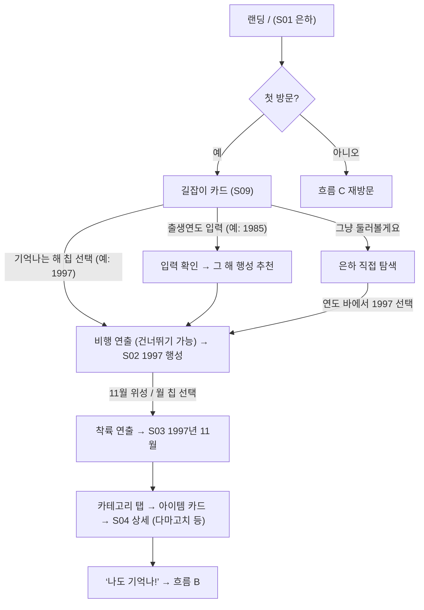
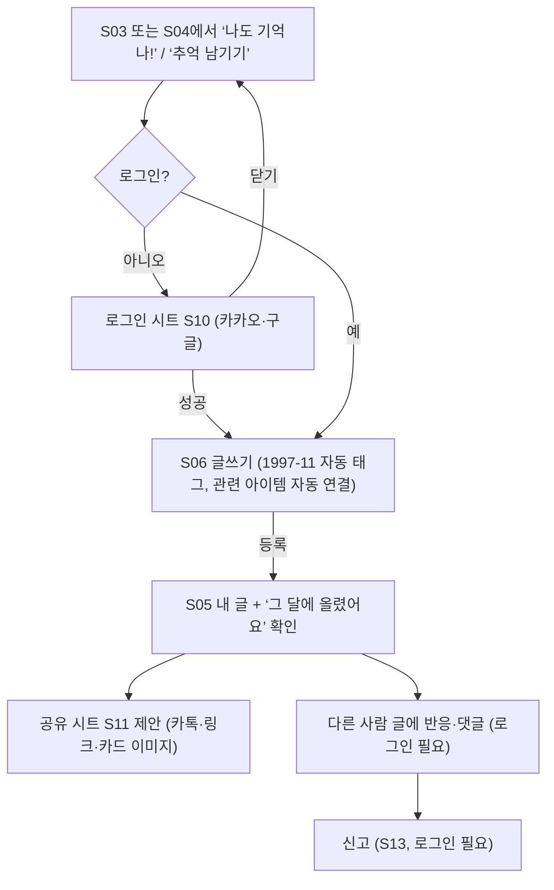

# 추억 타임머신 — 화면별 명세서

> 버전: v0.1 · 2026-11-17 · 상태: **기획·설계 단계. 코드 작성 없음. 설계 승인 전 구현하지 않는다.**
> 기준 문서: `추억타임머신_통합기획설계서.md` v4.0 (§0 목적, §4 핵심 경험, §6 커뮤니티, §8 인수 조건, §9·§13 출시 범위). 구조 참고: `웹미리보기.html`(예상도, 실제 화면 아님).
> 표기 — [확정] 사용자 결정 · [문서] 기준 문서에 이미 있는 내용 · [제안] 이 명세에서 추천 · [미정] 결정 필요 · [미확인] 검증 못 함
> 이 문서는 기준 문서를 대체하지 않는다. 충돌하면 기준 문서가 우선이고, 결정이 나면 기준 문서를 먼저 고친다.

---

## 0. 전제 (기준 문서에서 가져온 확정 사항)

| 항목 | 내용 | 근거 |
|---|---|---|
| 목적 | 연도·월별 추억 물건·노래·트렌드를 회상하고, 커뮤니티에서 공감·공유하고, 인스타·블로그·카톡으로 공유 | [확정] §0 |
| 대상 | 전 세대 | [확정] Q1 |
| 출시 범위 | 전체 완성형 (1950~2026 전체, 연도당 아이템 20개 이상, 월은 유연) | [확정] Q2·Q5 |
| 커뮤니티 | 글은 연도·월에 귀속, 그 달 화면과 전체·연대·주제 피드 양쪽에 표시 | [확정] Q3 |
| 이미지 | 공공·CC / AI 재현 + 배지 / 저작권 있는 것은 출처 링크 + 설명 / 사용자 업로드 4가지 병행 | [확정] Q4 |
| 사용자 제보 | 바로 반영하지 않고 관리자가 나중에 검토해 추가 | [확정] Q5-1 |
| 댓글 | 일반 댓글 + 반응(이모지·삐삐 암호) + 신고 | [확정] Q7-1 |
| 로그인 | 카카오, 구글 | [확정] Q8-1 |
| 수익 | 구글 애드센스 + 후원. 후원 문구 “추억 타임머신이 오래 여행할 수 있도록 응원해 주세요 ☕” | [확정] §11 |
| 카테고리 | 음악 / 영화·드라마·TV / 먹거리 / 패션 / 기술·가전 / 놀이·게임·장난감 / 사건·문화 (7개) | [문서] §5.1 |
| 시간 범위 | 1950~2026, 77개 연도, 924개 월 | [문서] §4.1 |
| 직접 진입 주소 | `/1997/11`, `/item/<id>`, `/post/<id>` | [문서] §4.3 |
| 앱이 아님 | 웹사이트. 구글 플레이 등록 없음 | [확정] §11 |

**이 명세가 따르는 설계 원칙 [제안]**
1. **3D 연출은 장식이다.** 연출 없이도 모든 기능과 모든 정보에 도달할 수 있어야 한다 (모든 화면에 일반 HTML 대체 본문이 있다. 검색 노출·애드센스 심사에도 필요 — 기준 문서 §10.2, §11).
2. **한 번 탭하면 콘텐츠.** 첫 방문자가 30초 안에 첫 콘텐츠를 본다 (G4).
3. **모든 연출에는 건너뛰기가 있다.**
4. **읽기는 로그인 없이, 참여만 로그인.**
5. **출처와 AI 여부를 숨기지 않는다.**

---

## 1. 사용자 흐름 3개

### 흐름 A. 첫 방문 → 1997년 11월 탐색



| 단계 | 사용자 행동 | 화면 반응 | 비고 |
|---|---|---|---|
| A1 | 사이트 접속 (`/`) | S01 은하 첫 화면 + 길잡이 카드(S09) 표시. 3D가 늦게 떠도 텍스트 영역(로고·검색·연도 바·길잡이 카드)이 먼저 보인다 | 3D는 지연 로딩 [제안] |
| A2-a | 길잡이의 “기억나는 해” 칩에서 `1997` 탭 | 길잡이 닫힘 → 비행(1→2초) → S02 | 칩에 오른 해는 실제 콘텐츠가 채워진 대표 연도만 [제안] |
| A2-b | 출생연도 `1985` 입력 → “가기” | “1985년 행성으로 갈게요” 확인 → 비행 → S02(1985). 출생연도는 이 기기에 저장 | 입력은 숫자 4자리, 한 칸 |
| A2-c | “그냥 둘러볼게요” | 길잡이 닫힘, 은하에서 직접 탐색. 길잡이는 다시 안 뜸(설정에서 재호출 가능) | |
| A3 | 연도 바 또는 은하의 `1997` 선택 | 비행: 궤도 이탈 → 곡선 비행 → 감속 안착 (≤2초, AC-01). 화면 우상단 “건너뛰기” 항상 표시 | 건너뛰면 즉시 도착 |
| A4 | S02에서 `11` 위성 또는 월 칩 선택 | 대기권 진입 → 착륙 (≤2초) → S03 `/1997/11` | 월 칩은 위성이 작아서 누르기 어려운 사람용 대체 수단 |
| A5 | S03에서 카테고리 탭, 카드 탐색 | 카드 목록 필터. 카드 탭 → S04 상세 | 같은 달 글(S03 하단)도 보임 |
| A6 | 다른 해로 이동 | 연도 바에서 `1998` 선택 → 같은 월(11)로 갈지 연도 개요로 갈지 [미정 Q-S11] | [제안] 현재 화면 층위 유지(월 화면이었으면 1998년 11월, 해당 월에 콘텐츠가 없으면 연도 화면) |

**공유 링크로 처음 온 경우 [제안]**: `/1997/11`, `/item/…`, `/post/…`로 바로 도착. 3D 연출 없이 해당 화면이 곧바로 열린다. 화면 상단에 “이 달을 처음 보시나요? 🚀 우주선 타고 둘러보기” 한 줄 (닫을 수 있음). 비로그인이어도 읽기·공유 가능. (AC-03)

### 흐름 B. 글·댓글·공유 (참여)



| 단계 | 사용자 행동 | 화면 반응 | 비고 |
|---|---|---|---|
| B1 | S04의 “🙋 나도 기억나!” 탭 | 비로그인이면 로그인 시트. **아이템과 연·월은 유지** | OAuth 이동 후 돌아와도 같은 상태로 복귀 [제안] |
| B2 | 카카오 또는 구글 선택 | 외부 로그인 → 돌아오면 원래 행동 이어서 실행. 첫 로그인이면 닉네임 확인 한 단계 | 닉네임 기본값은 임의 닉네임, 카카오 실명 사용 안 함 [제안] |
| B3 | 글쓰기 | S06: 연도·월은 맥락에서 채워짐(수정 가능), 카테고리, 제목, 본문, 사진 | AC-04: 1999년 5월로 쓰면 그 달 화면 + 전체 피드에 모두 표시 |
| B4 | 등록 | S05로 이동. “1999년 5월에 올렸어요” 안내 + “그 달에서 보기” 링크 | |
| B5 | 등록 직후 | 공유 시트(S11)를 **제안**만 하고 강요하지 않는다 (닫기 쉬움) | |
| B6 | 남의 글에서 반응 탭 | +1 (다시 탭하면 취소, AC-05). 비로그인이면 로그인 시트 후 이어서 | |
| B7 | 댓글 작성 | 입력창 → 등록 → 목록 맨 아래(또는 위 [미정]) 즉시 표시 | |
| B8 | 공유 | S11: 시스템 공유(지원 시) → 아니면 채널 버튼. 비로그인도 가능 | |

### 흐름 C. 재방문

| 단계 | 상황 | 화면 반응 | 비고 |
|---|---|---|---|
| C1 | 같은 기기로 다시 접속 | S01 상단에 “이어서 보기: 1997년 11월” 한 줄 (최근 본 연도·월). 길잡이는 다시 안 뜸 | 로컬 저장 [제안]. 로그인 시 계정에 동기화 [미정] |
| C2 | 출생연도가 저장돼 있음 | “내가 태어난 해 · 1985” 바로가기 칩 | 저장은 선택사항 |
| C3 | 로그인 상태 + 내 글에 답글/댓글 | 헤더 벨 아이콘에 읽지 않은 표시 → 알림 목록 | 알림 범위 [미정 Q-S3] |
| C4 | 매일 | “같은 날 다른 해” — 오늘 날짜의 10·20·30년 전 카드 (S01 하단 섹션) | [문서] §6.3 |
| C5 | 매주 | “추억 챌린지” 질문 카드 (예: “당신의 첫 핸드폰은?”) → 답하기는 S06으로 (질문이 연도·월 자동 태그 아님, 사용자가 고름) | [문서] §6.3, 운영 방식 [미정] |
| C6 | 알림/외부 링크로 `/post/…` 직행 | 3D 없이 글 화면 | 흐름 A의 “공유 링크로 온 경우”와 동일 |
| C7 | 3D 연출 경험 | 사용자가 연출을 껐으면 계속 꺼진 상태 (설정 유지). 연출이 켜져 있어도 연속 이동 시 전환 시간은 AC 상한 2초를 넘지 않는다 | |

[미정] 관심 시대 구독(§6.3)은 알림 범위(Q-S3)가 정해진 뒤 화면 설계. 이 명세에서는 자리만 둔다.

---

## 2. 화면 목록

| ID | 화면 | 주소 | 로그인 | 한 줄 설명 |
|---|---|---|---|---|
| S01 | 은하 (홈) | `/` | 불필요 | 연도 행성들. 첫 방문 길잡이·이어서 보기·오늘의 같은 날 |
| S02 | 연도 궤도 | `/1997` | 불필요 | 행성 + 1~12월 위성. 이 해의 대표 유행 요약 |
| S03 | 월 지표면 | `/1997/11` | 불필요 | 그 달의 유행 카드 + 그 달 추억 글 |
| S04 | 아이템 상세 | `/item/<id>` | 불필요 | 물건·노래·트렌드 하나의 상세. 출처·AI 배지·관련 글 |
| S05 | 글 상세 | `/post/<id>` | 불필요(읽기) | 추억 글 + 반응 + 댓글 + 공유 |
| S06 | 글쓰기·수정 | `/write` (또는 시트) | **필요** | 연·월 태그, 사진, 본문 |
| S07 | 전체·연대·주제 피드 | `/feed` | 불필요 | 모든 달의 글을 최신·인기·연대·카테고리로 |
| S08 | 검색 | `/search?q=` | 불필요 | 키워드·연도·카테고리, 아이템과 글 |
| S09 | 첫 방문 길잡이 | S01 위 오버레이 | 불필요 | 출생연도 입력 / 기억나는 해 선택 |
| S10 | 로그인 시트 | 모달 | — | 카카오·구글 |
| S11 | 공유 시트 | 모달·바텀시트 | 불필요 | 카톡·인스타·블로그·링크·카드 이미지 |
| S12 | 아이템 제보 | `/suggest` (또는 시트) | **필요** | “이 아이템 추가해 주세요” (관리자 검토 후 반영) |
| S13 | 신고·수정 제보 | 시트 | **필요** | 글·댓글 신고, 아이템 오류 제보 |
| S14 | 내 정보 | `/me` | **필요** | 내 글, 닉네임, 출생연도, 알림, 탈퇴 |
| S15 | 알림 | 헤더 패널 또는 `/me/alerts` | **필요** | 답글·댓글 알림 (범위 [미정]) |
| S16 | 설정 | 시트 | 불필요 | 연출 끄기·모션 줄이기·가벼운 모드·길잡이 다시 보기 |
| S17 | 안내 페이지 묶음 | `/about`, `/privacy`, `/terms`, `/guide`, `/sources`, `/support` | 불필요 | 소개·개인정보처리방침·이용약관·커뮤니티 가이드·출처 안내·후원 |
| S18 | 오류·예외 | 각종 | — | 404, 범위 밖 연도, 서버 오류, 오프라인 |
| S19 | 운영자 화면 (별도 명세) | `/admin` | 운영자 | 콘텐츠 등록·검수, 제보·신고 처리, 지표 |
| T1 | 비행·착륙 전환 (화면 아님) | — | — | L2.5 비행, L3 대기권 진입, L5 탈출 |

### 2.1 공통 구성요소

| 요소 | 구성 | 상태·동작 |
|---|---|---|
| **상단 바** | 로고(→S01), 검색(→S08), 설정(S16), 로그인/내 정보(S10/S14), 벨(S15, 로그인 시) | 모바일은 로고 + 검색 + 메뉴 아이콘 3개로 축약 |
| **연도 바** | 1950~2026 가로 스크롤. 선택 연도 확대·골드 글로우. ◀ ▶ 버튼 + 스와이프 + ←/→ 키. 연도 숫자를 탭하면 연대 선택 시트(1950s~2020s 탭 → 10개 칩) | 선택 연도는 `aria-current`. 콘텐츠 상태에 따라 점 표시 [제안] (아래 상태 표 참고) |
| **월 바** | 연도 선택 시 펼침. 1~12월 12칩, 콘텐츠 많은 달 강조, “3건의 추억” 배지 | 아이템 0건인 달도 선택 가능(글은 쓸 수 있음) — 흐리게 표시 |
| **건너뛰기 / 연출 끄기** | 비행·착륙 중 우상단에 즉시 노출되는 “건너뛰기(Esc)”. 상단 바에 “연출 끄기” 토글 | 상세는 §4 |
| **카드 (아이템)** | 4:3 썸네일 + 제목 + 한 줄 설명 + 카테고리 + `YYYY-MM` 배지 + 출처 표시 | 이미지 없음·AI 복원·저작권 링크형 변형 있음 (§2.2) |
| **카드 (글)** | 제목, 본문 앞 2줄, 연·월 배지, 카테고리, 반응 수, 댓글 수, 대표 사진(있으면) | 신고로 비공개된 글은 목록에 안 나옴 |
| **반응 바** | “아 이거!”, “ㅋㅋㅋ”, “울컥”, “486”, “8282” (이모지만 쓰지 않고 글자 라벨 항상 병기) | 탭 +1, 다시 탭 취소 (AC-05) |
| **공유 버튼** | 아이콘 + “공유” 글자 | → S11 |
| **카테고리 탭** | 전체 + 7개. 모바일은 가로 스크롤 칩 | |
| **광고 슬롯** | 본문 영역 하단·카드 목록 사이. **3D 캔버스 위·반응/연도 바/버튼 근처에는 두지 않는다** [제안] | 높이를 미리 확보해 화면이 밀리지 않게. 위치 확정은 애드센스 승인 후 [미정 Q-S16] |
| **푸터** | 소개, 개인정보처리방침, 이용약관, 커뮤니티 가이드, 출처 안내, 후원(☕ 문구), 문의·삭제 요청 | 애드센스 심사용 필수 페이지 연결 [제안] |
| **토스트** | 짧은 알림 (등록 완료, 링크 복사됨 등) | 스크린 리더에 읽힘(`role=status`), 5초 후 사라지되 포커스를 뺏지 않음 |

### 2.2 콘텐츠 상태 (모든 화면에서 같은 규칙으로 쓴다)

| 상태 | 뜻 | 표시 |
|---|---|---|
| **로딩** | 데이터 오는 중 | 카드 모양 스켈레톤(회색 틀). 3초 넘으면 “조금만 기다려 주세요” 한 줄 |
| **빈 상태 — 월에 아이템 없음** | 연도당 20개 이상, 월은 유연하므로 정상적인 상태 | “1997년 3월에는 아직 정리된 물건이 없어요. 이 해 전체 유행은 [1997년 보기]에서 볼 수 있어요.” + “나도 기억나는 게 있어요(제보)” + “추억 남기기” |
| **빈 상태 — 글 없음** | 그 달 글이 아직 없음 | “아직 이 달의 추억이 없어요. 첫 번째로 남겨 보세요.” + 글쓰기 버튼 |
| **빈 상태 — 검색 결과 없음** | AC-02 | “‘○○’에 대한 결과가 없어요” + 다른 검색어 제안 + “이 아이템 추가해 달라고 제보하기” |
| **콘텐츠 준비 중** | 연도·월·카테고리가 아직 검수·채우기 전. 또는 1950~70년대 이미지 자리 | 해당 영역에 “준비 중” 라벨 + 자리 그림(회색 별 모양). **검증 안 된 자료로 억지로 채우지 않는다** [문서] §4.1 |
| **연도 상태 (연도 바 점 표시)** | ● 충분(20개↑ 검수 완료) / ◐ 일부 / ○ 준비 중 | 색뿐 아니라 모양·툴팁/라벨 텍스트로도 구분 (색만으로 구분 금지) |
| **AI 복원 배지** | AI로 다시 그린 이미지 | 이미지 위 좌하단 “🤖 AI 사료 복원” 라벨 + 상세에서 참고 사료·확인 안 된 부분 표시. 이 배지는 **카드·상세·공유 카드·확대 보기 모두**에 따라간다 (AC-08) |
| **저작권 링크형** | 이미지 사용 불가, 출처 링크 + 설명 | 썸네일 대신 카테고리 아이콘 + “원본 보기 ↗” (외부 링크는 새 탭 표시) |
| **사용자 업로드 사진** | 글에 올린 사진 | “사용자 사진” 라벨 (공식 자료와 구분) [제안] |
| **시기 정확도** | 정확한 월 / 연도만 / 대략적 시기 | 카드·상세에 “1997-11” / “1997년” / “1997년경” 배지. 연도만인 아이템은 월 화면에서 “이 해 전체” 영역에 [제안] |
| **검토 중 / 비공개** | 신고 3건 누적으로 자동 비공개된 글 | 작성자에게만 “검토 중이라 다른 사람에게는 보이지 않아요” (AC-07). 다른 사람에게는 목록에서 제외, 직접 주소는 “볼 수 없는 글이에요” |
| **삭제됨** | 작성자 삭제 | “삭제된 글이에요” + 같은 달 보기 링크 |
| **오류** | 서버/네트워크 오류 | “불러오지 못했어요” + [다시 시도]. 이미 받은 내용은 유지 |
| **오프라인** | 연결 끊김 | 상단에 “오프라인이에요” 띠. 글쓰기 내용은 로컬 보관 후 복구 시 전송 안내 [제안] |

---

## 3. 화면별 명세

> 모바일(375px 기준, AC-06)을 먼저 정하고, 태블릿·데스크톱은 확장 규칙만 적는다. 반응형 경계는 §3.20.

### S01. 은하 (홈) — `/`

**목적**: 연도를 고르는 첫 화면. 3D 탐색과 빠른 선택을 둘 다 제공.

**모바일 배치 (375px)**
```
┌ 상단 바: 🚀 로고        🔍  ⚙  👤
├ 영역 A: 이어서 보기 칩 (재방문 시만)
├ 영역 B: 은하 캔버스 (화면 높이 ~55%)
│    시대 행성군 9개 (50S … 20S)
│    탭하면 확대 → 그 시대의 연도 행성들
├ 영역 C: 빠른 선택
│    [내 출생연도 1985]  [🔍 키워드로 찾기]
│    대표 연도 칩: 1988 · 1997 · 2002 · 2010 …
├ 영역 D: 같은 날 다른 해 (오늘 · 10·20·30년 전)
├ 영역 E: 최근 올라온 추억 글 3개 → [전체 피드]
├ 푸터
├ 연도 바 (하단 고정 위쪽 48px)  ◀ 1995 1996 [1997] 1998 ▶
└ 하단 탭: 탐험 · 검색 · ＋ · 피드 · 내 정보
```
- 모바일에서 77개 연도 행성을 한 화면에 띄우지 않는다. 9개 시대 행성군(§4.5 기준 문서)을 먼저 보여주고, 탭하면 그 시대의 연도로 확대한다 [제안].
- 데스크톱: 나선형 은하에 연도 행성 77개 표시 + 상단 고정 연도 바 [문서 §4.4].

**구성요소**: 상단 바 / 은하 캔버스 + 일반 HTML 연도 목록(대체) / 연도 바 / 길잡이 카드(S09, 첫 방문만) / 이어서 보기(재방문) / 같은 날 다른 해 / 최근 글 / 광고 슬롯(영역 E 아래) / 푸터

**상태**
| 상태 | 표시 |
|---|---|
| 로딩 | 로고·연도 바·빠른 선택 먼저 표시. 은하 영역은 별빛 배경 + “우주선 준비 중…”. 3D 로딩 중에도 연도 선택은 가능(바로 연도 페이지로 이동) |
| 3D 사용 불가·저사양 | 은하 대신 **시대별 카드 9개 + 연도 격자**(2D)로 대체 (§4) |
| 첫 방문 | 길잡이 카드 표시 |
| 재방문 | 이어서 보기·내 출생연도 칩·같은 날 다른 해 |
| 빈 상태 (최근 글 없음) | “아직 올라온 추억이 없어요. 첫 추억을 남겨 보세요” |
| 같은 날 다른 해에 아이템 없음 | 해당 줄을 숨기고 다른 연도로 대체 (빈 칸 노출 금지) |

**주요 동작**
- 연도 선택 → T1 비행 → S02. 시대 행성군 선택 → 확대 → 연도 선택.
- 키보드: 은하 캔버스는 포커스를 받지 않고, 같은 정보를 담은 **연도 목록(보이지 않거나 접힌 일반 링크 목록)**이 키보드·스크린 리더용으로 존재한다.
- 검색 상자 → S08. 로고 → 새로고침 없이 S01.

### S02. 연도 궤도 — `/1997`

**목적**: 한 해의 분위기를 보여주고 월을 고르게 한다. 검색·애드센스를 위한 **텍스트 본문이 있는 페이지**.

**모바일 배치**
```
┌ 상단 바
├ 연도 바 (1997 선택됨)
├ 헤더: 1997 · 사이버 펑크 행성 (시대 이름·색)
├ 궤도 캔버스: 행성 + 12개 위성 (월 번호)
├ 월 칩 줄: 1 2 3 … 12   (3D 대체 + 정밀 선택용)
├ “이 해의 대표 유행” — 카테고리별 대표 3~5개 (텍스트 + 작은 카드)
├ 광고 슬롯
├ “이 해의 추억 글” 인기 3개 → [이 해 글 모두 보기]
├ 이전 해 / 다음 해 링크
└ 하단 탭
```

**구성요소**: 연도 헤더(시대명·한 줄 소개) / 궤도 캔버스(12 위성, 콘텐츠 많은 달 강조) / 월 칩 / 이 해의 대표 유행(연도당 20개 이상에서 대표 선별) / 연도 전체 아이템 목록(카테고리별 접기) / 이 해 글 / 이전·다음 해 / 광고 슬롯

**상태**
| 상태 | 표시 |
|---|---|
| 로딩 | 헤더·월 칩 먼저, 대표 유행은 스켈레톤 |
| 연도 준비 중 (○) | “1957년은 아직 준비 중이에요. 곧 채워질 거예요.” + 이웃 연도 이동 + 글 쓰기는 허용 |
| 일부만 채움 (◐) | 있는 카테고리만 표시, 빈 카테고리는 “준비 중” 한 줄 |
| 월에 아이템 0건 | 해당 월 위성·칩을 흐리게. 선택하면 S03 빈 상태 |
| 1950~70년대 | 카드 이미지 자리는 “이미지 준비 중” (1차 텍스트만, 이후 AI 복원 배지 이미지) [문서 §5.3-4] |
| 저사양/모션 줄이기 | 궤도 캔버스 대신 **월 12칸 격자**(카드형) |

**주요 동작**: 월 칩/위성 선택 → T1 착륙 → S03. 위·아래 이동은 연도 바. 건너뛰기 항상 가능.

### S03. 월 지표면 — `/1997/11`

**목적**: 서비스의 핵심. 그 달의 유행 물건·노래·트렌드를 보고 그 달 사람들의 글에 공감한다.

**모바일 배치**
```
┌ 상단 바
├ 연도 바 → 월 바 (11월 골드 링, “3건의 추억”)
├ 헤더: 📍 1997년 11월    [🚀 우주로 돌아가기]  [공유]
├ 카테고리 칩: 전체 · 음악 · TV·영화 · 먹거리 · 패션 · 기술 · 놀이 · 사건
├ 아이템 카드 (모바일 1열)
│    다마고치 / 삐삐 음성사서함 / IMF 구제금융 신청 …
├ “이 해 전체 유행 (월 미상)” 접힘 영역
├ 광고 슬롯
├ 이 달의 추억 글 (카드 목록) + 정렬 [최신|인기]
├ [✏️ 나도 이 달의 추억 남기기]
├ 같은 해 다른 달 / 같은 달 다른 해 링크
└ 하단 탭
```

**구성요소**: 헤더·돌아가기·공유 / 카테고리 필터 / 아이템 카드 그리드(데스크톱 3열·태블릿 2열·모바일 1열 [문서 §4.6]) / 연도 전체 유행 접힘 영역 / 글 목록 / 글쓰기 CTA / 이웃 달·해 이동

**상태**
| 상태 | 표시 |
|---|---|
| 로딩 | 헤더·필터 + 카드 스켈레톤 6개 |
| 아이템 0건 | §2.2 “월에 아이템 없음” 안내 + 연도 보기 + 제보 + 글쓰기 |
| 카테고리 필터 결과 없음 | “이 카테고리에는 아직 없어요” + [전체 보기] |
| 글 없음 | “아직 이 달의 추억이 없어요” + 글쓰기 |
| 글 목록 더 보기 | 무한 스크롤보다 “더 보기” 버튼 [제안] (키보드·푸터 도달성) |
| 일부 아이템 이미지 없음·AI 복원·저작권 링크형 | §2.2 변형 카드 혼합 표시 |
| 월 화면 기본 필터 | 그 달 글만 (몰입). 전체 글은 S07에서 [확정 Q3] |

**주요 동작**: 카드 → S04. 글 카드 → S05. “우주로 돌아가기” → 상승 연출 → S01(또는 S02) — 건너뛰기 가능. 브라우저 뒤로가기는 직전 화면으로 이동하며 연출 없이 즉시 도착 [제안].

### S04. 아이템 상세 — `/item/<id>`

**목적**: 물건·노래·트렌드 하나의 정보. 신뢰(출처)와 참여(나도 기억나!)의 연결점.

**구성요소**
- 이미지 갤러리 (이미지 없음·AI 복원·저작권 링크형 변형)
- 제목, 카테고리, 시기 배지(`1997-11` / `1997년` / `1997년경`), 한 줄 설명, 본문 설명
- **출처 박스**: 출처명·URL·라이선스(공공누리 몇 유형·CC 종류 등)·검토 상태. 이미지 크레딧 별도
- AI 복원이면: “🤖 AI 사료 복원” 배지 + 참고 사료 목록 + “확인 안 된 부분”(예: 천막 색, 책상 모양)
- 🙋 **나도 기억나!** (→ S06, 연·월·아이템 자동 연결, 로그인 필요)
- 관련 추억 글 (이 아이템이 연결된 글, 최신순) + 더 보기
- 공유 / “틀린 곳이 있나요? 수정 제보” (→ S13)
- 같은 달 다른 아이템, 같은 카테고리 다른 해

**상태**
| 상태 | 표시 |
|---|---|
| 로딩 | 이미지 영역·제목 스켈레톤 |
| 이미지 없음 (1950~70년대 1차) | 카테고리 아이콘 + “이미지 준비 중” |
| AI 복원 | 배지 + 참고 사료 + 확인 안 된 부분 (필수 — 이 세 가지가 없으면 게시 불가, AC-08) |
| 저작권 링크형 | 본문 설명 + “원본 보기 ↗” |
| 관련 글 없음 | “아직 이 물건의 추억이 없어요. 첫 번째로 남겨 보세요” |
| 존재하지 않음/비공개 | S18 404, 같은 연도로 이동 링크 |

모바일은 이미지가 위, 정보가 아래 1열. 태블릿 이상은 좌 이미지·우 정보 2열 (웹미리보기 4번 구성 [문서 참고]).

### S05. 글 상세 — `/post/<id>`

**목적**: 한 사람의 추억 글을 읽고, 반응·댓글·공유로 이어진다.

**구성요소**
- 헤더: 연·월 배지(탭하면 S03), 카테고리, 제목, 작성자 닉네임·작성일, (본인이면) 수정·삭제 메뉴, (타인이면) ⋯ 메뉴 → 신고
- 본문 + 사진(사용자 사진 라벨)
- 연결된 아이템 카드(있으면)
- **반응 바**: 아 이거! / ㅋㅋㅋ / 울컥 / 486 / 8282 — 각 버튼에 글자 라벨과 수 표시
- 공유 버튼
- 댓글: 입력창(로그인 필요), 목록, 댓글별 신고. 답글 단계 [미정 Q-S5, 제안 1단계]
- 같은 달의 다른 글 / 이전·다음 글

**상태**
| 상태 | 표시 |
|---|---|
| 로딩 | 본문 스켈레톤 |
| 댓글 없음 | “첫 댓글을 남겨 보세요” |
| 비로그인 + 반응/댓글 | 입력창은 보이되 누르면 S10 (내용 유지) |
| 작성자 본인 + 신고 누적 비공개 | “검토 중이라 다른 사람에게는 보이지 않아요” 배너 + 이의 제기 링크 (AC-07, §6.4) |
| 타인 + 비공개/삭제 | “볼 수 없는 글이에요” |
| 반응 처리 중 | 낙관적 갱신(바로 +1) 후 실패 시 되돌리고 토스트 |

### S06. 글쓰기·수정 — `/write`, `/post/<id>/edit`

**목적**: 연·월에 귀속되는 추억 글 작성. **로그인 필요.**

**필드 [제안 — 한도 수치는 [미정 Q-S9]]**
| 필드 | 규칙 |
|---|---|
| 연도 | 필수. 맥락(S03의 연·월, S04 아이템의 시기)에서 자동 채움, 1950~2026 선택 |
| 월 | 선택. “월은 잘 모르겠어요” 허용 (연도만 귀속) |
| 카테고리 | 필수 7개 중 선택 + “그냥 일상 추억” [미정] |
| 연결 아이템 | 선택. “나도 기억나!”에서 오면 자동 연결, 바꾸기 가능 |
| 제목 | 필수 [제안 40자 이내] |
| 본문 | 필수 [제안 2,000자 이내] |
| 사진 | 선택 [제안 4장·장당 5MB 이내]. 올리기 전 안내: “다른 사람 얼굴·개인정보가 보이는 사진은 올리지 마세요” + “내가 찍었거나 올릴 권리가 있는 사진인가요?” 체크 |

**모바일 배치**: 풀스크린 단일 열. 상단 [취소] / [임시저장됨 ✓] / 하단 고정 [등록] (엄지 영역). 키보드가 올라와도 등록 버튼과 입력 중 필드가 가려지지 않게 한다.

**상태·동작**
| 상태 | 표시 |
|---|---|
| 비로그인 접근 | 로그인 시트 후 입력 상태로 복귀 |
| 작성 중 이탈 | 입력 내용 자동 임시저장(기기 로컬). 돌아오면 “이어서 쓸까요?” |
| 검증 오류 | 필드 옆 문구(색만으로 표시 금지). 첫 오류 필드로 포커스 이동 |
| 업로드 중·실패 | 사진별 진행률/재시도. 실패해도 글 내용은 유지 |
| 등록 성공 | S05로 이동 + 토스트 + 공유 제안(S11) |
| 등록 후 공개 방식 | [미정 Q-S2] [제안] 바로 공개 + 사후 신고·모더레이션. (아이템 제보는 승인제 [확정 Q5-1]) |
| 수정 | 연·월 변경 가능, 변경 시 이전 달에서 사라지고 새 달에 표시 |
| 삭제 | 확인 대화상자 → “삭제되었어요” |

### S07. 전체·연대·주제 피드 — `/feed`

**목적**: 모든 달의 글을 한곳에서 발견 (AC-04의 “전체 피드”).

**구성요소**: 정렬 탭(최신·인기) / 필터 칩(연대: 1950s~2020s, 카테고리 7개, “특정 연·월” 선택) / 글 카드 목록 / 더 보기 / 글쓰기 진입(하단 탭 ＋)

**상태**: 로딩(카드 스켈레톤) / 필터 결과 없음(“이 조건의 추억이 아직 없어요” + 필터 해제) / 피드 끝(“여기까지예요”) / 오류(다시 시도). 모바일은 필터가 칩 줄(가로 스크롤) + “필터” 시트.
[미정 Q-S10] 연대별로 독립 주소(`/era/90l` 등)가 필요한지, 필터로만 둘지.

### S08. 검색 — `/search?q=다마고치`

**목적**: 키워드·연도·카테고리로 아이템과 글을 찾는다 (AC-02).

**구성요소**: 검색창(자동 포커스, 지우기 버튼) / 결과 탭(전체·물건·글) / 필터(연도 범위, 카테고리) / 결과 카드(연도·카테고리 표시) / 최근 검색어(기기 로컬, 개별 삭제·전체 삭제) / 추천어(대표 아이템)

**상태**
| 상태 | 표시 |
|---|---|
| 검색 전 | 최근 검색어 + 추천어 |
| 입력 중 | 연관 후보 (한 글자 입력부터 가능, 요청은 입력 멈춘 뒤) |
| 결과 있음 | 연도·카테고리 포함 카드 목록 (“다마고치 — 1997 · 놀이”) |
| 결과 없음 | §2.2 + 아이템 제보 링크 (로그인 필요) |
| 로딩 | 스켈레톤 |
| 오류 | 다시 시도 |

### S09. 첫 방문 길잡이 — S01 위 오버레이

**목적**: 첫 화면에서 막히지 않고 “내 시절”로 가게 한다. **한 번의 입력 또는 한 번의 탭으로 끝**.

```
┌ 어느 해로 날아갈까요?
│  [ 몇 년생이세요?  ____ ]  [가기]
│  또는 기억나는 해:  1988  1997  2002  2010 …
│  [그냥 둘러볼게요]
└ 모든 정보는 이 기기에만 저장돼요 (로그인하면 계정에 저장 가능)
```
- 출생연도: 숫자 4자리. 범위 밖(예: 1930)이면 “가장 먼저 갈 수 있는 해는 1950이에요”로 안내하고 1950으로 이동. 2027 이상이면 2026. 숫자 아닌 입력은 인라인 안내.
- [제안] 출생연도로부터 “10대였던 시절”(출생+10~19)을 한 줄로 추천 (예: 1985년생 → 1995~2004 구간 칩). 추가 입력 요구 없음.
- 출생 월·일은 묻지 않는다 (개인정보 최소화).
- 닫기 방법: [그냥 둘러볼게요], 바깥 영역 탭, Esc, 닫기 버튼. 닫으면 첫 방문 플래그 저장 → 이후 자동으로 안 뜸. 설정(S16)에서 다시 열기.
- 포커스: 열릴 때 입력창이 아니라 **카드 제목**으로(스크린 리더가 맥락을 읽도록), 닫으면 이전 포커스 위치로 복귀.
- 노출 조건 [미정 Q-S11, 제안]: 첫 방문 1회. 직접 진입 주소(`/1997/11` 등)로 온 사용자에게는 뜨지 않는다.

### S10. 로그인 시트

- 제목: “로그인하고 추억을 남겨요” + 왜 필요한지 한 줄 (“글·댓글·반응을 남기려면 로그인이 필요해요. 읽기·검색·공유는 로그인 없이 돼요.”)
- 버튼 2개: **카카오로 계속하기**, **Google로 계속하기** (두 버튼 모두 44px 이상, 같은 크기). 애플 포함 여부는 [미정, 기준 Q8 🟢].
- 약관·개인정보처리방침 동의 문구 (첫 로그인 시): 링크 포함. 만 14세 미만 가입 처리 [미확인 — 개인정보 보호법상 확인 필요, 확정 전 문서화 필요] [미정 Q-S7].
- 첫 로그인 후: 닉네임 확인(임의 닉네임 기본값, 수정 가능, 중복·부적절어 검사) + 출생연도 입력(선택, 건너뛰기).
- 상태: 대기(외부 이동 중 “카카오로 이동하고 있어요…”) / 취소(되돌아오면 시트 닫고 원래 화면, 입력 내용 유지) / 실패(“로그인하지 못했어요. 다시 시도해 주세요” + 다른 방법) / 계정 연결 충돌(같은 이메일이 다른 제공자에 있음 — 처리 방식 [미정]).
- 로그인 후에는 **하려던 행동을 자동으로 이어서 실행** (반응 누르기·글쓰기·댓글·제보).

### S11. 공유 시트

**대상**: 월 화면, 아이템, 글, (선택) 길잡이 결과 “내 추억 카드”. **로그인 불필요.**

**구성요소**
1. **공유 카드 미리보기** — 1:1 및 세로형 중 선택 [미정]. 연·월, 대표 문구, 이미지(AI 복원이면 배지 포함), 사이트 이름. **닉네임은 기본으로 넣지 않는다** [문서 §4.7].
2. **채널 버튼**
   | 채널 | 동작 | 비고 |
   |---|---|---|
   | 기기 공유 | Web Share API (`navigator.share`) 먼저 시도 | HTTPS + 사용자 탭 필요. 지원 안 되면 아래 버튼만 표시 [문서] |
   | 카카오톡 | Kakao SDK 공유 | 키·도메인 등록 필요 [문서] |
   | 인스타그램 | 카드 이미지 저장 + “인스타 앱에서 새 게시물/스토리에 올려 주세요” 안내 | 웹에서 직접 올리는 공식 방법 없음 [문서]. 모바일에서 파일 공유가 되면 시도(`canShare` 확인) |
   | 네이버 블로그 | 링크 공유 | 실제 동작 확인 전 [미확인] |
   | 링크 복사 | 클립보드 복사 + 토스트 “링크를 복사했어요” | 항상 제공 (실패 시 선택해서 복사할 수 있게 입력창으로 대체) |
   | X·페이스북 | 공유 URL | [미확인] 검증 후 포함 여부 확정 |
3. **카드 이미지 저장** 버튼.

**상태**: 카드 생성 중(스켈레톤+“카드를 만들고 있어요”) / 생성 실패(링크만 공유로 대체) / 복사 성공·실패 토스트 / 공유 취소(조용히 닫힘).
모바일: 바텀 시트(드래그로 닫기 + 닫기 버튼 + Esc/뒤로가기).

### S12. 아이템 제보 — `/suggest`

**로그인 필요.** [확정 Q5-1] 제출한 내용은 **바로 사이트에 반영되지 않고** 관리자가 나중에 검토해 추가한다.
- 필드: 아이템 이름(필수), 연·월(필수/월은 모름 허용), 카테고리, 설명(선택), 출처 링크 또는 근거(선택), 사진(선택, 권리 안내 체크), 연락 필요 여부 [미정].
- 제출 후 안내: “접수되었어요. 관리자가 확인한 뒤 반영돼요. 바로 보이지는 않아요.” + 내 제보 상태(접수/검토 중/반영됨/반영 안 됨 + 이유) 보기는 S14 [제안].
- 상태: 입력 오류 / 제출 중 / 성공 / 실패(내용 유지) / 이미 비슷한 아이템 있음(제출 전 유사 후보 제시 [제안]).

### S13. 신고·수정 제보 시트

**로그인 필요 [제안].** 사유 선택(스팸·광고 / 욕설·혐오 / 개인정보 / 저작권 침해 / 사실 오류 / 기타) + 선택 설명 → 제출. 같은 대상 중복 신고 금지(내 신고 상태 표시).
- 3건 누적 시 글 자동 비공개 + 운영자 목록 등록 (AC-07). 3건은 **서로 다른 사용자** 기준 [제안].
- 아이템에 대한 “틀린 곳이 있나요?” 수정 제보도 같은 시트를 쓰되, 관리자 검토 후 반영 (사용자에게는 “확인 후 반영돼요” 안내).
- 상태: 제출됨 토스트 “신고가 접수되었어요” / 이미 신고함 / 실패.

### S14. 내 정보 — `/me`

**로그인 필요.** 탭: 내 글 / 내 댓글 / 내 제보 / 설정. 닉네임 변경, 출생연도(선택), 로그인 연결 정보, 알림 설정, 로그아웃, 회원 탈퇴(확인 단계, 탈퇴 시 글 처리 방식 선택 — 삭제/익명화 [미정]).
상태: 비어 있음(“아직 쓴 글이 없어요” + 글쓰기) / 비공개된 글 표시(검토 중 + 이의 제기) / 로딩 / 오류.

### S15. 알림 (범위 [미정 Q-S3])

[제안] 헤더 벨 → 사이트 내 알림 목록만 (내 글에 댓글, 내 댓글에 답글, 내 제보 처리 결과). 읽음 처리, 모두 읽음, 알림 없음 상태(“아직 알림이 없어요”). 푸시·이메일·카카오 알림톡은 이 명세 범위 밖.

### S16. 설정 시트 — 비로그인도 사용 가능

| 항목 | 값 | 기본값 |
|---|---|---|
| 우주선 연출 | 켬 / 끔 (끄면 모든 전환이 즉시 이동) | 켬 (OS가 모션 줄이기면 끔) |
| 모션 줄이기 | 켬 / 끔 | OS 설정 따라감 |
| 가벼운 모드 (3D 없이 2D) | 자동 / 항상 켬 / 항상 끔 | 자동 |
| 첫 방문 길잡이 다시 보기 | 버튼 | — |
| 내 출생연도 | 입력·삭제 | 없음 |
| 이 기기의 저장 정보 지우기 | 버튼 | — |

설정은 이 기기에 저장(로컬). 로그인하면 계정과 동기화할지 [미정].

### S17. 안내 페이지 묶음

| 페이지 | 필수 내용 |
|---|---|
| `/about` 소개 | 사이트 소개, 만든 이유, 연락처 |
| `/privacy` 개인정보처리방침 | 수집 항목(로그인 식별자·닉네임·출생연도 선택·업로드 사진), 보관·삭제, 광고·쿠키 안내 (애드센스 사용 시 필요 [문서 §11]) |
| `/terms` 이용약관 | 글·사진 권리, 금지 행위, 비공개·삭제 기준 |
| `/guide` 커뮤니티 가이드 | 개인 사진·타인 얼굴 안내, 신고·삭제 요청·이의 제기 절차, 정치·논쟁적 사건 글 가이드 [미정 §6.4, Q7] |
| `/sources` 출처·AI 안내 | 자료 출처·라이선스 표기 방식, AI 사료 복원 배지의 뜻, 오류 제보 방법 |
| `/support` 후원 | “추억 타임머신이 오래 여행할 수 있도록 응원해 주세요 ☕” + 외부 후원 링크. 법적 확인 전에는 링크 공개 보류 [미확인 §11] |

각 페이지는 일반 텍스트 문서(3D 없음), 푸터에서 항상 접근 가능.

### S18. 오류·예외

| 상황 | 표시 |
|---|---|
| 404 | “이 별은 지도에 없어요” + 홈/검색 링크 |
| 범위 밖 연도 (`/1949`, `/2030`) | “1950~2026년만 여행할 수 있어요” + 가장 가까운 연도 링크 |
| 잘못된 월 (`/1997/13`) | 연도 화면(S02)으로 이동 |
| 서버 오류 | 사과 문구 + 다시 시도 |
| 오프라인 | 상단 띠 + 이미 받은 화면은 읽기 가능 |
| JS 실행 불가 | 연도 목록·텍스트 본문이 일반 링크로 보이는 기본 HTML (글쓰기 등은 불가 안내) |
| 3D 오류 (WebGL 컨텍스트 소실 등) | 자동으로 2D 가벼운 모드로 전환 + 토스트 “가벼운 모드로 바꿨어요” |

### S19. 운영자 화면 (이 문서의 범위 밖, 목록만)

콘텐츠 등록·검수(수집→정제→태깅→검수→발행 [문서 §5.4]), 사용자 제보 큐 [확정 Q5-1], 신고 큐(AC-07), 기본 지표. **별도 명세 필요 [미정 Q-S17]**. 일반 사용자 화면과 같은 로그인 방식을 쓰되 권한은 분리.

### T1. 비행·착륙 전환 (화면이 아닌 연출)

| 전환 | 시간 [문서 §4.2] | 동작 |
|---|---|---|
| L2.5 연도→연도 비행 | 총 ≤2초 (페이드아웃 300ms → 후퇴 500ms → 워프 600ms → 접근 500ms) | 사이 연도 행성을 스쳐 지나감 |
| L3 대기권 진입 (연도→월) | ≤2초 | 수직 급강하 줌인 |
| L5 탈출 (월→은하/연도) | ≤2초 | 수직 상승 줌아웃 |
- 시작 즉시 우상단에 **건너뛰기(Esc)** 버튼(44px) 노출. 누르면 도착 화면이 바로 열린다.
- 전환 중에는 새 입력을 막지 않는다: 다른 연도를 또 누르면 현재 연출을 즉시 끝내고 새 목적지로 간다 [제안].
- 도착하면 포커스를 도착 화면의 제목(`h1`)으로 옮기고, 스크린 리더에 “1997년 행성에 도착했습니다”를 알린다.
- 브라우저 뒤로가기/앞으로가기: 연출 없이 즉시 이동 [제안].

---

## 3.20 반응형·모바일 우선 배치 규칙

| 구간 | 너비 | 카드 열 | 연도 바 | 하단 탭 |
|---|---|---|---|---|
| 모바일 | ≤599px (기준 375px, AC-06) | 1열 [문서] | 상단 고정 한 줄, 스와이프 + ◀▶ 버튼 | 표시 |
| 태블릿 | 600~1023px | 2열 [문서] | 상단 고정 | 표시 [제안] |
| 데스크톱 | ≥1024px | 3열 [문서] | 상단 고정 + ←/→ 키 | 숨김, 상단 메뉴 |
(경계값은 [제안])

**모바일 우선 원칙**
1. **한 손 엄지 영역**: 주요 행동(글쓰기·등록·공유·건너뛰기 제외 닫기)은 화면 하단 쪽에. 건너뛰기는 연출 중 시선이 가는 우상단에 두되 44px 이상.
2. **하단 탭 5개 [제안, [미정 Q-S6]]**: 탐험(S01) · 검색(S08) · ＋ 추억 남기기(S06) · 피드(S07) · 내 정보(S14, 비로그인이면 로그인).
3. **3D 영역은 화면의 절반 이하**로 두고, 스크롤로 텍스트 본문에 도달한다. 캔버스 안에서 가로 드래그와 페이지 세로 스크롤이 충돌하지 않게 한다.
4. **연도 바**: 현재 연도 중앙 정렬, 스와이프 + ◀▶ 버튼 + 연도 숫자 탭 → 연대 시트(10개 칩, 한 번에 2~3탭으로 임의 연도 도달). 77칸을 한 줄에 다 보여주지 않는다.
5. **위성(월) 터치**: 위성이 작아도 터치 영역은 44px 이상. 부족하면 월 칩 줄이 대체한다.
6. **키보드/주소창 대응**: 입력 필드가 가려지지 않게 스크롤, 하단 고정 버튼은 키보드 위에.
7. **노치/하단 바 안전 영역** 확보. 가로 모드는 지원하되 레이아웃은 데스크톱 규칙을 따른다.
8. **이미지**: 지연 로딩, 데이터 절약 모드에서는 작은 이미지 [제안].
9. **광고**: 3D 영역·탭 바·버튼 근처 금지, 높이 미리 확보 [제안].

---

## 4. 모션 줄이기 · 건너뛰기 · 저사양 대안

### 4.1 세 가지 상태 (서로 독립)

| 모드 | 켜지는 조건 | 3D 캔버스 | 전환 | 지속 애니메이션 |
|---|---|---|---|---|
| **전체 연출** | 기본 | 사용 | 비행·착륙 풀 연출(≤2초) | 별 반짝임, 위성 공전, 호버 떠오름 |
| **모션 줄이기** | OS “동작 줄이기” 감지(`prefers-reduced-motion`) 또는 설정 토글 | 정지 이미지·고정 구도로 표시 (움직이는 줌·패럴랙스·흔들림 없음) | **즉시 이동** 또는 150ms 이하 단순 페이드 | 위성 공전·별 반짝임 정지, 자동 재생 없음 |
| **저사양(가벼운 모드)** | WebGL 미지원, 초기화 실패, 프레임이 낮게 지속됨, 설정 | **없음. 2D 격자·카드로 대체** | CSS 페이드/슬라이드 (모션 줄이기와 겹치면 즉시) | 최소 |

- **모션 줄이기는 접근성 설정(움직임 자체를 줄이기), 저사양은 성능 대응이라 서로 다른 축**이다. 둘이 동시에 켜질 수 있다. 근거: W3C WCAG 2.2 SC 2.3.3 Animation from Interactions (https://www.w3.org/WAI/WCAG22/Understanding/animation-from-interactions) [문서 §4.3 인용].
- OS 설정은 기본값만 정한다. 사용자가 사이트 설정(S16)에서 바꿀 수 있고, 사이트 설정이 우선한다. 설정은 로컬에 저장하며 저장 실패해도 현재 방문에서는 동작해야 한다 [제안].

### 4.2 건너뛰기 규칙

1. 모든 비행·착륙·탈출 연출 시작 **즉시** 건너뛰기 버튼 표시 (지연 표시 금지).
2. 입력 수단: 화면 버튼(44px) / `Esc` / 연출 영역 탭 두 번 [제안] / 스크린 리더용 버튼 라벨 “연출 건너뛰기”.
3. 건너뛰면 **끝 상태로 즉시 이동**한다 (중간 상태 정지 금지).
4. 상단 바의 “연출 끄기” 토글로 영구 해제 (S16과 동일 값).
5. 같은 연출을 2번째부터는 매번 같은 길이로 진행하되, 사용자가 연속으로 이동하면 앞 연출을 즉시 마무리하고 새 이동으로 간다 (전환이 쌓이지 않음).

### 4.3 성능 기준과 자동 전환 [제안]

- 목표: 30~60fps [문서 PRD], 전환 2초 이내 [문서 AC-01].
- 자동 감지: WebGL 사용 가능 여부, 초기화 실패, 연출 중 프레임이 낮은 상태가 반복되면 “움직임이 버벅여요. 가벼운 모드로 바꿀까요?” 한 줄 제안(수락 시 즉시 2D, 거절 시 이 방문 동안 다시 묻지 않음). 임계값(몇 fps, 몇 초)은 프로토타입 측정 후 확정 [미정].
- 데이터 절약 모드 감지가 가능한 브라우저에서는 큰 이미지·3D 사전 로딩을 줄인다 (브라우저별 지원 차이 [미확인]).
- 3D 에셋은 첫 화면 이후 지연 로딩. **연도 선택·검색·읽기는 3D 로딩과 무관하게 동작**한다.
- 가벼운 모드 동작: S01 = 시대 카드 9개 + 연도 격자, S02 = 월 12칸 격자, S03 = 동일(원래 2D), S04~S08 = 동일.
- 번쩍임: 워프 입자 등 깜빡이는 효과는 초당 3회 이하 [제안] (WCAG 2.3.1 Three Flashes or Below Threshold 기준 준용, 적용 방식은 구현 단계에서 확인).
- 반복되는 움직임(위성 공전·별 반짝임)이 5초 넘게 이어지면 일시정지 버튼 제공 [제안] (WCAG 2.2.2 Pause, Stop, Hide 취지).

### 4.4 화면별 대체 동작 표

| 화면 | 전체 연출 | 모션 줄이기 | 저사양 (3D 없음) |
|---|---|---|---|
| S01 | 나선 은하, 행성 부유 | 정지한 은하 이미지 + 선택 시 즉시 이동 | 시대 카드 9 + 연도 격자 |
| S02 | 행성 + 공전하는 위성 | 정지한 행성 + 위성 고정 | 월 12칸 격자 |
| S03 | 대기권 착륙, 카드 호버 떠오름 | 즉시 표시, 호버 효과 없음 | 즉시 표시, 단순 호버 |
| T1 | 비행·착륙 풀 연출 | 즉시 이동 / 150ms 페이드 | 짧은 CSS 페이드 또는 즉시 |
| 상세·피드·검색 | 부드러운 시트 열림 | 즉시 열림 | 동일 |

---

## 5. 로그인(카카오·구글)이 필요한 행동

**원칙**: 읽기·탐색·검색·공유는 로그인 없이. 남에게 영향이 가는 행동과 개인 데이터는 로그인.

| 행동 | 로그인 | 비고 |
|---|---|---|
| 연도·월·아이템·글·피드 보기, 검색 | 불필요 | |
| 공유 시트 사용, 링크 복사, 카드 이미지 저장 | 불필요 | 닉네임 기본 비노출 |
| 설정(연출 끄기 등), 출생연도 로컬 저장 | 불필요 | 이 기기에만 |
| 후원·안내 페이지 보기 | 불필요 | |
| **글 쓰기** | **필요** | 입력 내용 보존 후 복귀 |
| 글 수정·삭제 (본인) | 필요 | |
| 글 사진 업로드 | 필요 | 글쓰기 안에서 |
| **댓글 쓰기·수정·삭제** | **필요** | |
| **반응 누르기·취소** (아 이거!·ㅋㅋㅋ·울컥·486·8282) | 필요 [제안] | 중복 방지·조작 방지. 로그인 후 반응이 이어서 실행 |
| **신고** (글·댓글) | 필요 [제안] | 3건 누적 기준을 서로 다른 사용자로 셈 |
| **아이템 제보 / 수정 제보** | 필요 | 관리자 검토 후 반영 [확정 Q5-1] |
| “나도 기억나!” (글쓰기 진입) | 필요 | 아이템·연·월 유지 |
| 알림 보기·설정 | 필요 | 범위 [미정 Q-S3] |
| 내 정보(내 글·댓글·제보) | 필요 | |
| 출생연도를 계정에 저장 | 필요 | 비로그인은 로컬만 |
| 주간 챌린지 답하기 | 필요 | S06 경유 |
| 관심 시대 구독 | 필요 | [미정] |
| 회원 탈퇴·로그아웃 | 필요 | |

**로그인 후 이어서 실행(필수 동작)**: 비로그인으로 어떤 참여 행동을 시도하면 → S10 → 로그인 성공 → 원래 화면·스크롤·입력 내용 복원 → 행동 자동 실행(예: 반응 +1). 로그인 중 취소하면 원래 화면에 남는다. OAuth 이동으로 상태가 사라질 수 있으므로 이동 전에 행동 정보를 기기에 임시 보관한다 [제안].

---

## 6. 접근성 기본

기준: WCAG 2.2 AA를 목표로 한다 [제안, 기준 문서에는 §4.3 모션 항목과 터치 44px만 명시됨]. 공식 문서: https://www.w3.org/TR/WCAG22/ (2.4.7 Focus Visible, 2.4.11 Focus Not Obscured (Minimum), 1.4.3 Contrast (Minimum), 1.4.11 Non-text Contrast, 2.5.7 Dragging Movements, 2.5.8 Target Size (Minimum), 2.5.5 Target Size (Enhanced)).

### 6.1 키보드
| 키 | 동작 |
|---|---|
| Tab / Shift+Tab | 화면 순서대로 이동: 본문 건너뛰기 링크 → 상단 바 → 연도 바 → 본문 → 하단 |
| ← / → | 연도 바(포커스가 연도 바에 있을 때): 이전/다음 연도 [문서 §4.4] |
| Home / End | 1950 / 2026 [제안] |
| PageUp / PageDown | 10년 이동 [제안] |
| Enter / Space | 선택 |
| Esc | 연출 건너뛰기, 시트·모달 닫기 |
| ↑/↓ | 월 칩·카테고리 칩 이동 [제안] |
- 모든 기능은 마우스·터치 없이 가능해야 한다. 3D 캔버스는 포커스 함정이 되지 않으며, 같은 기능을 하는 **일반 HTML 컨트롤**이 항상 존재한다.
- “본문으로 건너뛰기” 링크를 첫 Tab에 제공 [제안].
- 모달·시트: 열면 포커스가 안으로, Tab이 안에서 순환, Esc로 닫고 포커스는 연 버튼으로 복귀.
- 화면 전환 후 포커스는 새 화면 제목으로. 고정 연도 바·하단 탭이 포커스된 요소를 가리지 않게 한다 (WCAG 2.4.11).
- 포커스 표시는 모든 배경(어두운 우주·밝은 카드)에서 구분되는 두꺼운 고대비 링.

### 6.2 대비·글자·색
- 본문·정보 텍스트 대비 4.5:1 이상, 큰 글자·아이콘·테두리 3:1 이상. 기준 팔레트(#0d1b2a 바탕, #ffd700 골드, #e94560 핑크, #9aa6b8 흐린 글씨)의 실제 대비 값은 **[미확인] 측정 후 확정**. 특히 **네온 핑크 #e94560을 작은 글씨에 단독으로 쓰지 않는다** [제안].
- 글자 크기: 본문 16px 이상, 보조 텍스트 14px 이상 [제안]. 브라우저 확대 200%에서 가로 스크롤 없이 읽혀야 한다(연도 바 같은 의도된 가로 스크롤 영역 제외).
- **색만으로 의미를 전달하지 않는다**: 연도 상태(●◐○), 시대 색, 오류, 선택 상태는 모양·글자·밑줄을 병행.
- 이모지 단독 사용 금지: 반응 버튼은 글자 라벨 필수. “486”, “8282” 같은 삐삐 암호는 뜻을 짧게 병기 (예: 486 = “사랑해”는 [미확인 → 콘텐츠 작성 시 확인], 8282 = “빨리빨리”).
- VHS 필터·색수차·비네팅 같은 장식 효과는 텍스트 가독성을 해치지 않게 이미지에만 적용하고 글자 위에는 두지 않는다 [제안].
- 다크 코스믹 단일 테마 [문서]. 라이트 모드 필요 여부 [미정].

### 6.3 터치·크기
- 모든 누를 수 있는 요소 **44×44px 이상** [문서 §4.6, AC-06] (WCAG 2.5.5 Enhanced 수준, AA 기준 2.5.8은 24px). 작은 아이콘도 투명 터치 영역으로 보강. 인접 요소 간 최소 간격 확보 [제안].
- **드래그에만 의존하지 않는다**: 연도 바 스와이프는 ◀▶ 버튼과 연대 시트로 대체 가능 (WCAG 2.5.7).
- 길게 누르기·핀치·두 손가락 제스처에 필수 기능을 두지 않는다.

### 6.4 스크린 리더·마크업 [제안]
- 문서 언어 `ko`. 페이지마다 고유한 제목과 `h1` (예: “1997년 11월 — 추억 타임머신”).
- 3D 캔버스는 장식 처리(`aria-hidden`)하고 같은 정보를 일반 목록으로 제공. 도착·로딩 완료·반응 변경·토스트는 정중한 알림 영역(`aria-live=polite`)으로 읽어줌.
- 연도 바: 현재 연도 `aria-current`, 각 칩에 “1997년, 콘텐츠 충분” 같은 이름.
- 이미지: 아이템 이미지에 대체 텍스트, **AI 복원 여부를 대체 텍스트에도 포함** (“AI로 복원한 그림: …”). 장식 이미지는 빈 대체 텍스트.
- 폼: 라벨 연결, 오류는 필드 옆 텍스트 + 오류 요약, 필수 표시는 글자(`필수`)로.
- 링크 새 탭 열림 표시 (“원본 보기 ↗ (새 창)”).
- 시간 제한 없음. 자동 로그아웃 전에는 경고 [제안].

### 6.5 점검 방법 [제안, 구현 후]
키보드만으로 흐름 A·B·C 완주 / 스크린 리더(모바일 TalkBack·VoiceOver 중 1개 이상)로 S02·S03·S05 읽기 / 200% 확대 / 모션 줄이기 켠 상태로 전체 흐름 / 자동 검사 도구 + 수동 점검.

---

## 7. 인수 조건 대응표 (기준 문서 §8)

| AC | 관련 화면 | 이 명세의 반영 위치 |
|---|---|---|
| AC-01 탐색 2초·건너뛰기 즉시 | S01, S02, T1 | §3 T1, §4.2 |
| AC-02 검색·빈 상태 | S08 | S08 상태 표, §2.2 |
| AC-03 직접 진입 | S03, S04, S05 | 흐름 A “공유 링크로 온 경우”, S18 예외 |
| AC-04 글쓰기 → 그 달 + 전체 피드 | S06, S03, S07 | 흐름 B, S06, S07 |
| AC-05 반응 토글 | S05 | 공통 반응 바, §5 |
| AC-06 375px 연도 바 스크롤·1열·44px | 전 화면 | §3.20, §6.3 |
| AC-07 신고 3건 자동 비공개 | S13, S05, S19 | S13, §2.2 “검토 중/비공개” |
| AC-08 AI 배지·참고 사료 | S04, 카드, S11 | §2.2 “AI 복원 배지”, S04, S11 |
| G4 첫 콘텐츠 30초 | S01, S09 | 설계 원칙 2, S09 |

---

## 8. 결정 대기 항목 (이 명세에서 새로 생긴 것)

| # | 질문 | 제안 | 영향 화면 |
|---|---|---|---|
| Q-S1 | 출시 시점에 1950~70년대 이미지가 AI 복원으로 채워지나, “이미지 준비 중”으로 나가나? (기준 문서 §5.3-4는 1차 텍스트만, §9는 전체 완성형 — 시점 관계 불명) | 출시 전 결정 필요 | S02~S04, S11 |
| Q-S2 | 글 등록 즉시 공개 vs 승인 후 공개? | 즉시 공개 + 사후 신고·모더레이션 | S06, S05 |
| Q-S3 | 알림 범위와 방식 (사이트 내만 / 이메일 / 카카오 알림톡) | 사이트 내 알림 목록만 | S15, 흐름 C |
| Q-S4 | 반응 중복 규칙: 한 글에 여러 종류 가능? 댓글에도 반응? | 글에만, 종류별 독립 토글 | S05 |
| Q-S5 | 댓글 답글 단계 | 1단계 | S05 |
| Q-S6 | 모바일 하단 탭 구성과 연도 바 위치 | 탭 5개 + 연도 바 상단 고정 | 전 화면 |
| Q-S7 | 만 14세 미만 가입·개인정보 동의 처리 | 법령 확인 필요 [미확인] | S10 |
| Q-S8 | 반응·신고를 비로그인에 허용할지 | 둘 다 로그인 필요 | §5 |
| Q-S9 | 글 길이·사진 수·용량 한도 | 제목 40자, 본문 2,000자, 사진 4장·5MB | S06 |
| Q-S10 | 연대별 독립 주소 필요 여부 | 필터로만 | S07 |
| Q-S11 | 연도 이동 시 월 유지 규칙, 길잡이 노출 조건 | 층위 유지(월→월), 첫 방문 1회 | 흐름 A, S09 |
| Q-S12 | 닉네임 정책 (카카오·구글 이름 노출 금지, 임의 닉네임 기본) | 임의 닉네임 | S10, S14 |
| Q-S13 | 연도만 정해진(월 미상) 아이템을 월 화면에 어떻게 보일지 | “이 해 전체 유행” 접힘 영역 | S03 |
| Q-S14 | 카테고리 “그냥 일상 추억” 추가 여부 | 검토 | S06 |
| Q-S15 | 라이트 모드 필요 여부 | 다크 단일 | 전 화면 |
| Q-S16 | 광고 슬롯 위치 | 애드센스 승인 후 | 목록·상세 |
| Q-S17 | 운영자 화면 별도 명세 | 필요 | S19 |
| Q-S18 | 설정·출생연도를 계정에 동기화할지 | 로그인 시 동기화 | S16, S14 |

**기준 문서 쪽에서 이어서 결정해야 하는 것** (이 명세가 의존): Q4 이미지·저작권 전략 세부, Q5 시드 콘텐츠 분량·방식, Q6 기술 스택, Q7 댓글·논쟁 사건 가이드, 공유 채널별 [미확인] 항목(네이버 블로그·X·페이스북·카카오 무료 한도).

---

## 9. 다음 순서

1. 이 명세 검토 → Q-S1~Q-S18 결정
2. 핵심 화면(S01·S02·S03·S04·S06) 와이어프레임 (모바일 375 먼저, 이후 데스크톱)
3. 프로토타입에서 연출 성능(fps) 측정 → §4.3 임계값 확정
4. 대비 측정 → §6.2 팔레트 확정
5. 콘텐츠 기준서(§5.5) 확정 → 기술 확정 → 구현 계획
6. **설계 승인 전에는 구현하지 않는다.**
