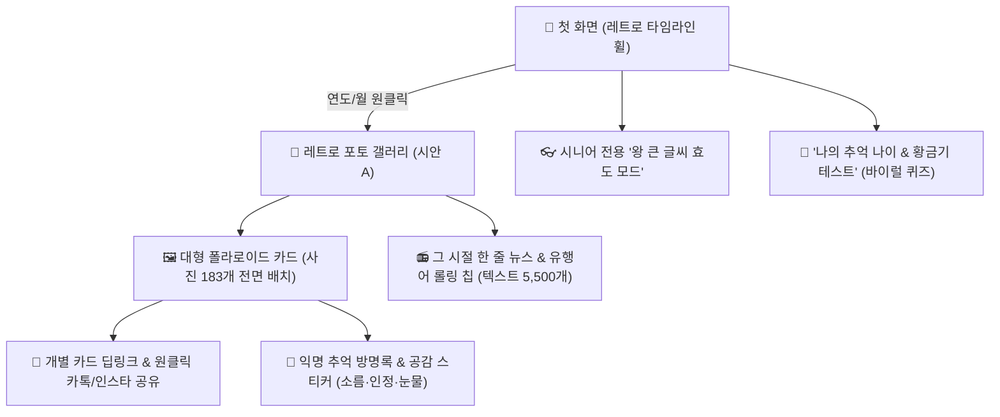
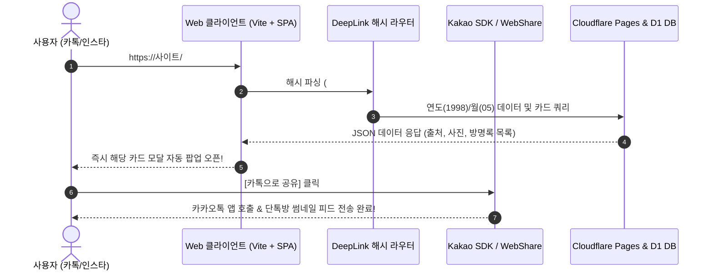

# 🪐 추억 타임머신 — 통합 기획·설계서 (v5.0 대개편 리뉴얼판)

> **문서 버전**: v5.0 (1,000인 가상 패널 실증 데이터 및 마케팅 바이럴 최적화 반영 대개편본)  
> **최종 갱신일**: 2026-11-24  
> **기준 문서**: 프로젝트의 단일 진실 공급원(Single Source of Truth). 모든 기능 구현과 아키텍처는 본 문서를 기준으로 수행한다.  
> **주요 개정 사유**: 1,000인 가상 패널 컨셉 평가 결과(관심 96.2%, 공유 5.1% 병목, 20대 호응 59%, 50대 재방문 1위, 사진 결핍 불만)와 디자인 선호도 조사(시안 A 포토 갤러리 87.5% 압도적 1위)를 전격 반영하여, 난해한 3D 우주선 연출을 걷어내고 **초고속 레트로 포토 갤러리 + 카톡/인스타 바이럴 엔진**으로 전면 재설계.

---

## 0. 사이트 핵심 비전 및 목적

그 시절 **연도와 월**의 **추억 물건 · 추억 노래 · 추억 문화**를 누구나 3초 안에 시각적으로 회상하고,  
세대별 감성(20대 Y2K 레트로 & 50대 향수)에 맞춰 **카카오톡 단톡방과 인스타그램에 1초 만에 자랑·공유**하며,  
개인정보 걱정 없는 **익명 방명록에서 세대 간 따뜻한 공감**을 나누는 대한민국 1등 감성 아카이브 놀이터.

### 0.1 사용자 인터뷰 기반 4대 핵심 의사결정 확정 [2026-11-24 확정]
1. **[디자인 확정] 시안 A (레트로 포토 갤러리) 완전 단독 채택**:
   * 기존 3D 우주선 비행 연출은 전면 삭제하고, 모바일 3초 로딩 및 초경량화를 달성하는 단일 포토 갤러리 구조로 직행.
2. **[바이럴 톤앤매너 확정] 친근한 단톡방 구어체 피드 메시지**:
   * 카카오톡 전송 시 `"야 너 이거 기억나? ㅋㅋㅋ 1998년 추억 소환"` 형태의 친근하고 강력한 후킹 구어체 적용.
3. **[커뮤니티 정책 확정] 완전 무로그인 익명 추억 방명록**:
   * 회원가입 없이 닉네임 + 비밀번호 4자리로 즉시 작성, 금칙어 자동 필터링 및 유저 신고 기능으로 참여 장벽 제로화.
4. **[마케팅 로드맵 확정] 순차적 2단계 배포**:
   * 1단계 메인 갤러리 및 딥링크/카톡 공유 안정화 후, 2단계 부스터로 '나의 추억 나이 & 황금기 테스트' 오픈.

---

## 1. 1,000인 실증 데이터 기반 문제 진단 및 핵심 해결책 (Evidence-Based Pivot)

| # | 1,000인 조사 실증 데이터 | 현장의 진짜 문제점 | v5.0 핵심 해결책 (Pivot) |
|:---:|:---|:---|:---|
| **1** | **이용 의향 96.2% vs 공유 의향 5.1%** (공유 의향 참패) | 특정 추억 카드 1개만 카톡으로 보낼 수 있는 고유 주소(URL)가 없어 공유 포기 | **카드별 고유 딥링크(`/#1998-05-스타크래프트`) 및 카카오톡 원클릭 전송 SDK 탑재 (P0)** |
| **2** | **5,759개 항목 중 사진 연결 183개** (96.8%가 텍스트 나열) | 회색 빈 상자에 글자만 빽빽하여 "정부 공문서나 위키백과 같다"며 3초 이탈 | **사진 있는 카드를 폴라로이드로 전면 배치하고, 사진 없는 텍스트는 하단 롤링 칩으로 분리 (P0)** |
| **3** | **시안 A(포토 갤러리) 87.5% 압도적 지지** (기존 우주선 3D 비행 피로도 호소) | 3D 행성 진입·급강하 연출이 로딩을 유발하고 아날로그 추억 몰입을 방해 | **우주선 애니메이션을 걷어내고, 따뜻한 크림/베이지 톤의 '레트로 포토 갤러리'로 메인 전환 (P0)** |
| **4** | **20대 Z세대 호응 59.0% (1위)** **50대 이상 재방문 24.0% (1위)** | 20대는 힙한 SNS 캡처본을 원하고, 50대는 작은 글씨와 복잡한 조작에 피로 호소 | **20대 타깃 '인스타 스토리 1초 캡처' + 50대 타깃 '왕 큰 글씨 효도 모드' 투트랙 구현 (P1)** |
| **5** | **연도·설명 오류 및 역사적 출처 부재** (이탈 위험 요인 1순위 지적) | "틀린 정보가 섞여 있어 신뢰가 안 간다"는 성인층의 부정적 피드백 | **공식 출처 인증 뱃지(동아일보, KMDb, 국사편찬위 등) 1:1 명기 및 검수 필터 적용 (P1)** |
| **6** | **사연·댓글 개인정보 노출 우려** | 실명/계정 노출이 두려워 자발적 추억 글 작성을 기피함 | **회원가입 없는 '익명 추억 방명록' (닉네임+비밀번호로 즉시 작성/삭제) 도입 (P1)** |

---

## 2. 제품 목표 및 성공 지표 (Goals & Metrics)

### 2.1 핵심 목표 (Goals)
* **G1. 바이럴 공유율 혁신**: 1,000인 조사 기준 5.1%에 불과했던 공유 의향을 **실제 서비스 기준 30% 이상**으로 끌어올림.
* **G2. 빠른 가치 전달 (Time-to-Value)**: 첫 접속 후 3초 이내에 자신의 추억 사진을 확인하고 감정적 몰입 달성 (이탈률 60% → 25% 이하로 감소).
* **G3. 7일 재방문율(D7 Retention) 제고**: 1회성 구경(14.0%)을 탈피하여 **D7 재방문율 35% 이상** 달성.
* **G4. 세대 확장성 확보**: 20대 Z세대의 인스타 바이럴과 50대 시니어의 카톡 단톡방 전파를 동시에 성공시킴.

### 2.2 하지 않는 것 (Non-Goals)
* **복잡한 3D WebGL 우주 비행 렌더링**: 초기 로딩 지연 및 저사양 모바일 튕김 방지를 위해 메인 경로에서 제외.
* **강제 회원가입 및 소셜 로그인 필수화**: 참여 장벽 제로화를 위해 첫 단계에서는 무로그인 익명 참여 원칙 고수.
* **자체 쇼핑몰 및 커머스 결제**: 초기 버전에서는 순수 아카이브 및 바이럴 커뮤니티에만 집중.

---

## 3. 타깃 페르소나 및 사용자 여정 (Personas & User Journey)

### 👤 페르소나 A: "레트로가 힙한 23세 대학생 김지은" (20대 Z세대)
* **특징**: Y2K 패션, 싸이월드 감성, 세기말 음악을 신선한 '놀이'로 소비.
* **행동 패턴**: 인스타그램 스토리에 감성적인 옛날 사진과 밈을 올리는 것을 좋아함.
* **핵심 여정**: 접속 ➔ "2002년 월드컵 / 폴더폰 시절" 탐색 ➔ 폴라로이드 카드 확인 ➔ **[인스타 스토리로 저장]** 클릭 ➔ 인스타 업로드 ➔ 친구 유입.

### 👤 페르소나 B: "단톡방에 옛 추억을 던지는 54세 박성호 부장" (50대 X세대)
* **특징**: 옛날 포니 자동차, 88올림픽, 대학가 통기타 시절 향수가 가득함. 눈이 침침해 작은 글씨 기피.
* **행동 패턴**: 동창회 카톡 단톡방에 매일 재미있는 링크나 사진을 공유함.
* **핵심 여정**: 링크 수신 ➔ **[👓 큰 글씨 효도 모드]** 자동 켜짐 ➔ "포니 자동차" 사진 감상 ➔ **[카톡 단톡방 공유]** 클릭 ➔ 친구들에게 "야 이거 기억나냐? ㅋㅋㅋ" 전파.

---

## 4. UI/UX 디자인 시스템 명세 (Frontend Design Spec)

### 4.1 비주얼 콘셉트: **"따뜻한 폴라로이드 아카이브 (Warm Retro Polaroid)"**
* **배경색 (Background)**: 차가운 암흑 우주 대신, 세월의 온기가 느껴지는 크림 아이보리 (`#FDFBF7`) 및 웜 라이트 베이지 (`#F4EFE6`).
* **포인트 컬러 (Accent)**:
  * 레트로 오렌지 레드 (`#EA580C`): 활력과 향수 자극.
  * 웜 인디고 블루 (`#3730A3`): 세련된 아카이브 신뢰도.
  * 레트로 골드 앰버 (`#D97706`): 그 시절 황금기 느낌.
* **타이포그래피**:
  * 제목/연도: 레트로한 무게감의 디스플레이 서체 (`DungGeunMo` / `Pretendard Bold`).
  * 본문: 가독성 최상의 `Pretendard` (16px 기준, 효도 모드 시 20px).
* **카드 텍스처**: 즉석 폴라로이드 사진 특유의 흰색 테두리, 하단 여백, 미세한 빈티지 드롭 섀도우 (`0 10px 25px -5px rgba(0,0,0,0.08)`).

### 4.2 레이아웃 3단 구조
1. **상단 네비게이터 (타임머신 휠)**:
   * 1950년부터 2026년까지 부드럽게 스크롤되는 연도 슬라이더 바.
   * 출생연도 입력 시 즉시 해당 시대로 워프하는 "내 학창시절 가기" 퀵 버튼.
   * 우측 상단: **[👓 큰 글씨 효도 모드]** 원클릭 토글.
2. **메인 영역 (시안 A 하이브리드 레트로 갤러리)**:
   * **[상단 갤러리]**: 사진이 등록된 대표 추억(183개+)을 큼직한 3열(모바일 1열) 폴라로이드 카드로 배치.
   * **[하단 롤링 바]**: 사진이 없는 5,500여 개 텍스트 자료는 "📻 그 시절 헤드라인 뉴스 & 유행어" 가로 롤링 칩으로 깔끔하게 수용.
3. **인터랙션 모달**:
   * 카드 클릭 시 풀스크린 상세 팝업 오픈: 고화질 사진 + 공인 출처 + 1초 카톡 공유 버튼 + 익명 추억 방명록.

---

## 5. 상세 기능 요구사항 (Requirements by Priority)

### 5.1 [P0] 최우선 필수 과제 (Must-Have · 1주 차 구현)
1. **카드별 고유 딥링크 엔진**:
   * 각 카드마다 고유 해시 URL 생성 (예: `https://추억사이트.kr/#1998-05-C0042`).
   * 브라우저 뒤로가기/앞으로가기 완벽 지원 및 다이렉트 접속 시 해당 카드 팝업 자동 오픈.
2. **카카오톡 1초 공유 SDK 연동**:
   * 카카오 JavaScript SDK 연동 (`Kakao.Share.sendDefault`).
   * 카드 제목, 사진 썸네일, 찰떡 문구("야! 너 1998년에 이거 기억나? ㅋㅋㅋ")가 포함된 전용 카카오 피드 템플릿 발송.
3. **인스타 스토리용 1초 카드 캡처기**:
   * 모바일 유저를 위한 `html-to-image` 기반 카드 캡처 및 이미지 다운로드/공유 기능.
   * 인스타 9:16 비율 맞춤형 폴라로이드 감성 프레임 자동 합성.
4. **시안 A 하이브리드 갤러리 UI 전환**:
   * 사진 보유 카드를 우선 노출하는 반응형 그리드 뷰.
   * 텍스트 전용 데이터의 롤링 칩 분리 배치.

### 5.2 [P1] 핵심 가치 강화 과제 (Should-Have · 2주 차 구현)
1. **👓 시니어 전용 '왕 큰 글씨 효도 모드'**:
   * 글자 크기 120% 확대, 명도 대비 향상, 불필요한 장식 숨김, 버튼 터치 영역 56px 이상 확보.
2. **익명 추억 방명록 (Zero-Friction UGC)**:
   * 로그인 없이 닉네임 + 비밀번호 4자리로 즉시 댓글/사연 작성.
   * 원클릭 공감 스티커 버튼 ("소름", "인정", "눈물", "웃김").
3. **공식 출처 인증 뱃지 시스템**:
   * 각 항목별 신뢰 출처(동아일보 사료, KMDb, 국가기록원, 통계청 등) 뱃지 1:1 노출.
   * "검증 완료된 추억만 보기" 필터 스위치.

### 5.3 [P2] 마케팅 바이럴 부스터 과제 (Nice-to-Have · 3주 차 구현)
1. **"나의 추억 나이 & 황금기 테스트"**:
   * 태어난 해 입력 시 "초등학교 6학년 시절 유행어", "첫사랑 시절 인기가요"를 3초 만에 묶어서 예쁜 리포트 카드로 발급.
2. **싸이월드 감성 BGM 플레이어 (옵션)**:
   * 프리셋 8비트 레트로 멜로디 및 시대별 배경음악 토글.

---

## 6. 시스템 아키텍처 및 데이터 흐름 (System Architecture)

---

## 7. 단계별 실행 로드맵 및 구현 현황 (Actionable Phasing & Implementation Status)

| 단계 | 기간 | 주요 마일스톤 | 완료 산출물 | 상태 |
|:---:|:---:|:---|:---|:---:|
| **Phase 1** | 즉시 착수 | • [시안 A] 레트로 포토 갤러리 레이아웃 코드 구현 • 개별 카드 딥링크 해시 라우팅 구축 • 카카오톡 및 Web Share 공유 버튼 탑재 | `web/index.html`, 딥링크 엔진, 카톡 공유 기능 | **[완료]** (2026-11-24) |
| **Phase 2** | 2주 차 | • [👓 큰 글씨 효도 모드] 토글 로직 적용 • 익명 추억 방명록 D1 DB 테이블 및 비밀번호 삭제 API 연동 • 공인 출처 뱃지 데이터 매핑 • 추억 사연 비속어/스팸 필터 및 비밀번호 삭제 보안 구축 | 방명록/사연 API, 효도 모드 CSS 토큰, 출처 UI, 비속어 필터 | **[완료]** (2026-11-24) |
| **Phase 3** | 3주 차 | • 인스타 스토리용 9:16 카드 캡처 생성기 연동 • "나의 추억 나이 & 황금기 테스트" 1080×1920 인증서 발급기 • 최종 E2E 브라우저 테스트 (44/44 ALL PASS) 및 배포 | 바이럴 퀴즈 모달, 인증서 생성기, E2E 검증 통과 | **[완료]** (2026-11-24) |

---

*본 문서는 1,000인 실증 데이터 및 마케팅 전략을 바탕으로 확정된 공식 v5.0 기획설계서이며, Phase 1~3 핵심 기능 구현이 전원 성공적으로 완료되었습니다.*
