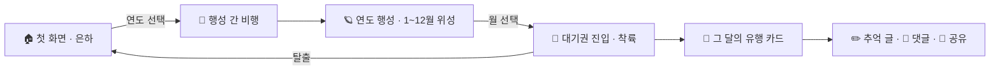
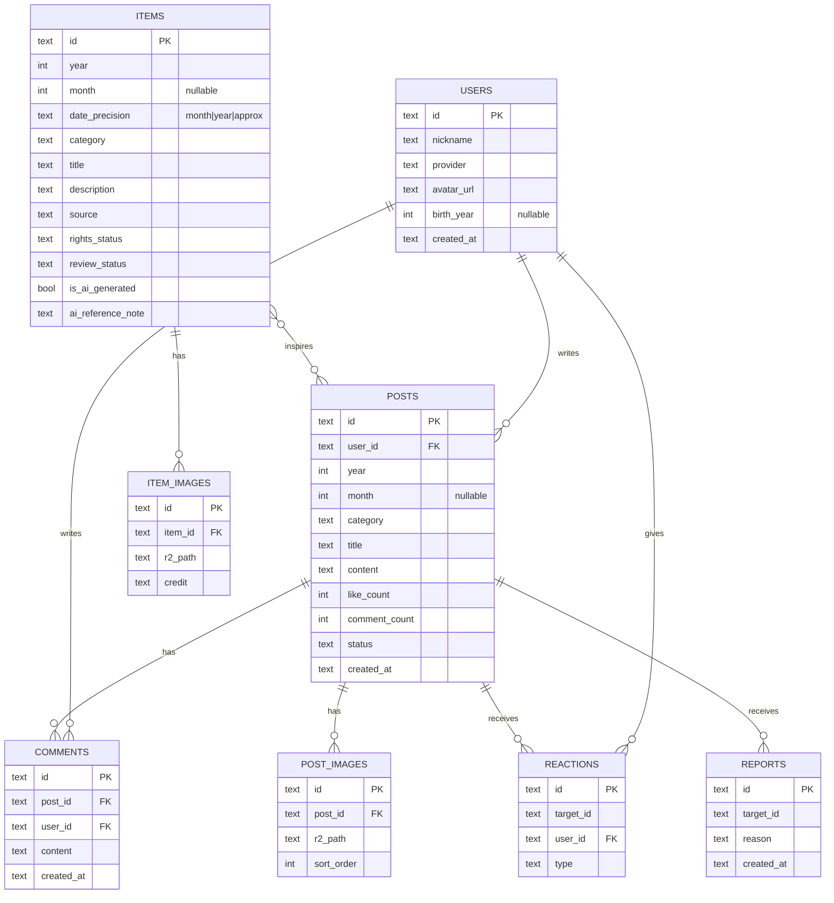

# 🪐 추억 타임머신 — 통합 기획·설계서

> 버전: v4.0 통합본 · 2026-11-17
> 통합 대상(삭제됨, 원본은 `원본문서_백업_20261118.zip`): eli5, 브레인스토밍, 기획설계 v1.0, PRD v1.0, 아키텍처 ADR v1.0, 시네마틱 기획설계서 v3.0, 2026-11-17 기획검토
> 상태: **기획·설계 단계. 구현 전.** 표기 — [확정] 사용자 결정 · [문서] 기존 문서 내용 · [제안] 정리하며 추천 · [미정] 결정 필요
> 이 문서가 유일한 기준 문서다. 새 결정은 이 문서를 고친다.

---

## 0. 사이트 목적 [확정 2026-11-17 · 사용자 원문 요지]

그 시대 **연도와 월**의 **추억 물건 · 추억 노래 · 추억 트렌드**를 회상하고,
사람들이 그때 추억을 **커뮤니티에서 서로 공감·공유**하며,
**인스타그램 · 블로그 · 카카오톡 등에 공유**할 수 있게 한다.
→ 이 목적에 맞는 자료를 모두 수집하는 것이 첫 과제다.

## 1. 한 줄 요약

연도는 행성, 월은 위성. 우주선을 타고 1950~2026년 한국의 시대를 날아다니며 그 시절 유행을 구경하고, 같은 시기를 기억하는 사람들과 이야기를 나누는 웹사이트.



---

## 2. 문제와 목표

### 2.1 문제 [문서: PRD]
- 과거 유행 정보가 블로그·커뮤니티·유튜브·나무위키에 흩어져 있어 "2003년에 뭐가 유행했지?"를 한 곳에서 보기 어렵다.
- 같은 시대를 산 사람들끼리 추억을 나눌 전용 공간이 없다. SNS에서는 묻히고, 위키는 정보형일 뿐이다.

### 2.2 목표 [문서: PRD — 수치는 모두 가설]
| # | 목표 | 측정 | 가설 목표치 |
|---|---|---|---|
| G1 | 연도·월별 콘텐츠를 구조화된 타임라인으로 제공 | 커버 연도·월 수, 연도당 콘텐츠 수 | §9 출시 범위에서 재설정 |
| G2 | 몰입하는 탐색 경험 | 세션당 탐색 연도 수, 체류 시간 | 3개 이상, 5분 이상 |
| G3 | 활성 커뮤니티 | 월간 UGC, 글당 댓글 | 월 500건, 글당 3개 |
| G4 | 첫 방문자의 빠른 가치 인식 | 랜딩→첫 콘텐츠 조회 | 30초 이내 |
| G5 | 재방문 | D7·D30 리텐션 | 25% · 10% |

### 2.3 하지 않는 것 (Non-Goals) [문서: PRD]
실시간 라이브·음성 채팅 / 자체 굿즈 쇼핑몰 / 네이티브 앱 / AI 개인화 추천 / 다국어 — 모두 첫 출시 이후 검토.

---

## 3. 대상 사용자

| 세그먼트 | 연령 | 핵심 니즈 | 출처 |
|---|---|---|---|
| 90년대 키즈 (프라이머리) | 30~40대 | "그때 그 시절" 향수, 참여 | 기획·PRD |
| 2000년대 키즈 | 20~30대 | 자기 세대 정리, SNS 공유 | 기획 |
| 부모 세대 | 50~70대 | 1950~80년대 회상 | v3.0 |
| Z세대 (탐색형) | 10~20대 | "이런 게 유행이었어?" | 기획 |
| 크리에이터·리서처 | 전 연령 | 시대별 트렌드 소재·검색·비교 | PRD |
| 운영자(큐레이터) | — | 콘텐츠 CMS, 모더레이션, 지표 | PRD |

페르소나 [문서: PRD]: 민수(38, 90년대 회상) · 지은(29, 크리에이터) · 하윤(34, 커뮤니티) · 타임키퍼(운영진).

**[미정] Q1 — 첫 출시 1순위 대상.**

---

## 4. 핵심 경험 설계

### 4.1 시간 범위
- [문서: v3.0] 1950~2026, 77개 연도. 924개 월(77×12).
- [제안] 비전(은하 전체)은 77년을 보여주되, 실제 콘텐츠가 채워진 시기만 "열림", 나머지는 "준비 중"으로 표시. 빈 공간을 검증 안 된 자료로 채우지 않는다.

### 4.2 카메라 여정 (5단계) [문서: v3.0]
| 단계 | 화면 | 동작 |
|---|---|---|
| L1 은하 | 1950~2026 나선형 은하 | 연도 행성 선택 |
| L2 연도 궤도 | 행성 + 1~12월 위성 공전 | 월 선택 / 다른 연도 선택 |
| L2.5 행성 간 비행 | 예) 1993→1998 | ① 궤도 이탈(살짝 후진) ② 스플라인 곡선 비행, 사이 연도 행성을 스쳐 지나감 + 워프 입자 ③ 감속 회전하며 새 궤도 안착. 새로고침 없는 연속 장면 |
| L3 대기권 진입 | 수직 급강하 줌인 | — |
| L4 지표면 | 그 연도·월의 유행 유물 + 카드 + 글 | 탐색·참여 |
| L5 탈출 | 수직 상승 줌아웃 | 은하로 복귀 |

시간 기준 [문서: 기획] 전환 1.5~2초, AC는 2초 이내. 세부: 콘텐츠 페이드아웃 300ms → 후퇴 500ms → 워프 600ms → 접근 500ms.

### 4.3 반드시 함께 들어갈 것 [제안 — 검토서 반영]
- **건너뛰기 / 빠른 이동**: 연출 없이 바로 이동하는 버튼.
- **모션 줄이기**: `prefers-reduced-motion` 존중 + 사이트 내 토글 (W3C WCAG 2.2 SC 2.3.3, https://www.w3.org/WAI/WCAG22/Understanding/animation-from-interactions).
- **저사양 대안**: WebGL 미지원·저성능 시 CSS 전환으로 대체. 목표 30~60fps [문서: PRD].
- **직접 진입 주소**: `/1997/11`, `/item/<id>`, `/post/<id>` — 공유 링크로 3D 연출 없이도 바로 도착.
- **첫 방문 길잡이**: 출생연도 또는 "기억하는 해" 선택 → 바로 그 행성으로. 키워드 검색.

### 4.4 타임라인 UI [문서: 기획]
- 연도 바: 상단 고정, 가로 스크롤·드래그·스와이프, ←/→ 키, 선택 연도 확대+글로우, 호버 시 대표 아이콘.
- 월 바: 연도 클릭 시 펼침, 12개 노드(콘텐츠 많은 달은 크게), 선택 월 골드 링, "3건의 추억" 배지.

### 4.5 시대 테마 [문서: v3.0 9개 행성군 — 기획 v1.0의 5년 단위 7개 테마는 대체]
| 코드 | 구간 | 이름·색 | 대표 아이템 | 자료 방식 |
|---|---|---|---|---|
| 50S | 1950~59 | 전후 잿더미와 희망 · Sepia Dust | 천막 학교, C-레이션, 판자촌, 라디오 드라마 | AI 사료 복원 |
| 60S | 1960~69 | 흑백 재건과 근대화 · Monochrome Steel | 삼양라면, 흑백TV, 대한극장 | AI 복원 + 공공기록 |
| 70S | 1970~79 | 청년 문화와 통기타 · Vintage Indigo | 통기타, 나팔 청바지, 포니 | AI 복원 + 신문 사료 |
| 80S | 1980~89 | 컬러 혁명과 호돌이 · Olympic Gold | 컬러TV, 88올림픽, 조용필 | AI 복원 + 초기 컬러 자료 |
| 90E | 1990~94 | 아날로그 여명 · Warm Amber | 서태지, 삐삐, 가요톱10 | 실제 자료 |
| 90L | 1995~99 | 사이버 펑크 · Neon Magenta | PC통신, 다마고치, H.O.T., IMF | 실제 자료 |
| 00S | 2000~09 | 밀레니엄 붉은 함성 · Silver & Red | 싸이월드, 2002 월드컵, 가로본능 | 실제 자료 |
| 10S | 2010~19 | 스마트 초연결 · Sky Cyan | 카톡, 애니팡, 강남스타일 | 실제 자료 |
| 20S | 2020~26 | 네오 숏폼 · Ultra Violet | 포켓몬빵 띠부씰, 달고나 커피, AI 일상화 | 실제 자료 |

(v3.0 제목의 "8대"는 오기 → 9개로 정정.) 대표 아이템은 예시이며 출처 검증 전이다.

### 4.6 디자인 방향 [문서: 기획]
"코스믹 노스탤지어" — 차가운 미래에서 따뜻한 과거를 바라보는 느낌.
- 색: 딥 네이비 #0d1b2a 베이스 + 코스믹 퍼플 #533483 + 네온 핑크 #e94560 + 골드 #ffd700. 시대별 행성색은 §4.5.
- 글꼴: Pretendard(한글), Space Grotesk(영문).
- 이미지 톤: 약한 VHS 필터·색수차·비네팅.
- 카드: 4:3, 데스크톱 3열/태블릿 2열/모바일 1열, 호버 시 살짝 떠오름. 터치 영역 최소 44px.
- 감성 요소는 절제한다 — 과하면 키치가 된다 [문서: 브레인스토밍].

### 4.7 공유 기능 (사이트 핵심 목적) — 조사 요약 (상세: `조사\공유기능_조사.md`, 일부 [미확인])
| 채널 | 방법 | 비고 |
|---|---|---|
| 카카오톡 | Kakao JavaScript SDK `Kakao.Share` (sendDefault·sendCustom·sendScrap) | JavaScript 키 + 사이트 도메인 등록 필요. 이미지 5MB 이하, 카카오 서버 최대 100일 보관 [확인]. 무료 한도 수치 [미확인] |
| 인스타그램 | 웹에서 바로 올리는 공식 방법 없음 | 대안: 공유 카드 이미지 저장 · 모바일 파일 공유(Web Share) · 링크 복사 |
| 모바일 공통 | Web Share API (`navigator.share`) | HTTPS + 사용자 클릭 필요. iOS Safari·Chrome Android·삼성 인터넷 지원, Firefox 데스크톱 미지원 [확인]. 파일 공유는 `canShare` 먼저 확인 |
| 네이버 블로그 | share.naver.com 계열 | 공식 문서 못 찾음 [미확인] → 실제 동작 테스트 후 사용 |
| X · 페이스북 | 공유 URL 인텐트 | [미확인] |

구현 방향 [제안]: ① Web Share를 먼저 쓰고 안 되면 채널별 버튼으로 ② 연도·월·아이템 페이지는 빌드 때 프리렌더 + 공유 카드(OG) 이미지 생성 ③ 커뮤니티 글은 Pages Functions + HTMLRewriter로 메타태그 주입, 이미지는 satori 계열로 만들어 캐시 ④ 카카오는 OG 캐시가 남으므로 이미지 URL에 버전 값을 붙임 ⑤ 공유 카드에는 닉네임을 기본으로 노출하지 않음.

---

## 5. 콘텐츠

### 5.1 카테고리
음악 / 영화·드라마·TV / 먹거리 / 패션 / 기술·가전 / 놀이·게임·장난감 / 사건·문화

### 5.2 아이템 카드·상세
- 카드: 썸네일 + 제목 + 한 줄 설명 + 카테고리 + YYYY-MM 배지 + 출처 표시.
- 상세: 갤러리 + 설명 + 관련 추억 글 + "나도 기억나!"(글쓰기로 연결, 연도·월 자동 태그).

### 5.3 자료 출처 후보 [문서: 기획·v3.0 — 각 출처 이용 조건은 미확인]
| 분야 | 후보 |
|---|---|
| 음악 | 멜론·써클(가온) 차트, KBS 가요톱10 기록 |
| 영화·드라마 | KOBIS(영화진흥위원회) 오픈API, 방송사 편성 기록 |
| 게임 | 한국콘텐츠진흥원, 게임 매체 아카이브 |
| 패션·생활 | 네이버 뉴스 라이브러리, 잡지 아카이브 |
| 문화·통계 | 국립민속박물관, 통계청, 공공데이터포털 |
| 1950~80년대 | 국사편찬위원회, 국가기록원, 옛 신문 |
| 이미지 | 공공누리, CC 라이선스(Flickr 등), 직접 제작 |

### 5.3-1 조사 결과 요약 (2026-11-17, 상세: `조사\` 폴더 3개 파일 · [미확인] 다수 남음)
| 구분 | 출처 |
|---|---|
| API로 바로 수집 가능 | KOBIS 영화 오픈API · KMDb(영상자료원) · 위키데이터 SPARQL(CC0) · 한국어 위키백과 API/덤프(CC BY-SA, 연도별 사건) · KOSIS OpenAPI(통계) · 네이버 데이터랩(2016~) · e뮤지엄 API(data.go.kr) |
| 파싱 필요·조건 확인 필요 | 써클차트(2010~, API 없음) · 닐슨코리아 시청률 웹 공개 · 빅카인즈(API는 선정자 한정, 엑셀 다운로드 가능) |
| 사용 어려움 | 멜론(robots 차단) · 나무위키(비영리 라이선스·크롤링 차단 → 애드센스 사이트엔 부적합) · 네이버 뉴스 라이브러리(링크만) · 1990년 이전 가요·시청률(공식 출처 없음) · 지상파 과거 편성표 |
| 이미지(바로 쓸 곳) | 서울역사아카이브(공공누리 1유형, 약 2.6만 건) · 국립민속박물관(1유형, 기증자료는 건별 확인) · Wikimedia Commons · Flickr CC |
| 법·규정 | 썸네일 판례는 2006년(대법원 2005도7793)뿐 → 저작권 있는 이미지는 링크+설명이 안전 · AI 기본법 2026-01-22 시행, AI 생성물 표시 의무(이 사이트 적용 여부 [미확인]) |

결론 [제안]: 뼈대는 **위키백과 연도 문서 + 위키데이터**로 연도·월 사건/작품 목록을 만들고, KOBIS·KMDb·KOSIS로 보강하고, 이미지는 서울역사아카이브·민속박물관·Commons를 쓴다. 1950~80년대의 빈칸은 AI 재현으로 채운다.

### 5.3-2 기존 추억 아카이브 사이트 조사 (상세: `조사\기존_추억아카이브사이트.md` · 17곳, 약관·API 대부분 [미확인])
- **빈자리 [검색 한 번 기준, 추가 확인 필요]**: 1950~2026을 연도·월 단위로 정리하면서 공감·공유까지 되는 국내 사이트는 찾지 못했다. 공공 아카이브는 믿을 만하지만 회상·공유 기능이 없고, 커뮤니티 게시판은 연도별 정리가 없다.
- **자동 수집 금지 확인**: 광고정보센터(약 30종 AI·크롤러 차단), Retro Junk(약 35종 차단 + AI 학습 불가·권리 유보 명시) → 두 곳은 **링크 + 출처 표기만** 한다.
- **데이터로 쓸 만한 곳**: 공공데이터포털·문화포털 오픈API(인증키) > 국립민속박물관(도메인 nfm.go.kr로 추정, API 여부는 data.go.kr에서 확인 필요) > Internet Archive. 음악은 곡명·가수 같은 사실 정보만 쓰고 음원·가사·앨범 이미지는 쓰지 않는다.
- **벤치마킹**: 한 해를 한 페이지에 묶기(The People History 방식 + 월 단위) · 사용자가 연도 태그를 달아 추억 올리기 · 등록 기준 규칙(예: "출시 7년 이상만") · 출생연도 세대 필터 · 카톡·인스타·블로그 공유 카드 · 지도와 연도 결합.

### 5.3-3 물건·노래·트렌드 심층 조사 (상세: `조사\데이터출처_물건노래트렌드_심층.md` · 대부분 2차 자료 기준, [미확인] 다수)
| 분야 | 확인된 것 | 못 확인한 것 |
|---|---|---|
| 노래 | 위키백과 「가요톱10」에 1981~1998 주간 1위가 연도별 불릿 목록(CC BY-SA)으로 있음 — 직접 열어 확인 | 마니아디비(/api 403, API 문서 못 찾음) · 벅스·지니·KOMCA·KBS 아카이브 · 1950~70년대 공식 순위 |
| 물건 | 통계청 소비자물가 대표품목 개편의 추가·제외 품목이 시대상 데이터(예: 1995년 기준 삐삐·노트북 추가, 레코드판 제외 — 1995·2015·2020·2025안은 언론 보도로만 확인) | 제조사 공식 연혁 URL (신라면 1986.10 출시 등은 언론으로만 확인) |
| 트렌드 | 국립국어원 신어 자료집(1994~, 연 단위) · e영상역사관 대한뉴스(1953~1994, 약 2,040호, 영상은 KTV 나누리 무료 안내) | 신어 자료집 API·라이선스·다운로드 위치 · 대한뉴스 연도별 탐색 · 광고정보센터 광고물DB(서버 교체 중, 중단 공지) |

**시대별 가능성 [추정]**: 1950~70년대는 대한뉴스·위키 위주라 연도당 20개를 채우기 가장 어렵고, 1980년대 이후는 20개를 넘길 수 있다고 본다. → 이 시기의 빈칸은 AI 재현·사용자 제보(관리자 검토)로 보강한다.
**다음에 확인**: 제조사 연혁 페이지, 벅스·지니 robots.txt·약관, 신어 자료집 다운로드 위치.

### 5.3-4 수집 단계 구분 [확정 2026-11-17 · 사용자 지시]
| 구간 | 1차 프로젝트(지금) | 이후 |
|---|---|---|
| **1950~70년대** | **텍스트만 수집**: 그 시절 무엇이 유행했는지 글로 정리(출처 URL 필수) | **2차 프로젝트**: 모인 텍스트를 바탕으로 AI 가상 이미지 생성(이해를 돕기 위한 재현, `AI 사료 복원` 배지) |
| **1980년대 이후** | 인터넷 이미지·데이터 아카이브에서 **수집(크롤링·API) 가능한 사이트를 조사·분석** 후 수집 | — |
- 1차 프로젝트에서는 1950~70년대 이미지를 만들지 않는다. 카드는 텍스트 + 출처로 먼저 채우고, 이미지 자리는 "준비 중"으로 둔다.
- 수집 원칙: 사실 정보(제목·시기·설명)는 직접 정리해 쓰고, 출처 URL·라이선스·시기 정확도를 항목마다 기록한다. robots.txt·약관상 금지된 곳은 자동 수집하지 않고 링크만 한다.

### 5.4 2원화 자료 파이프라인 [문서: v3.0]
- 1990년 이후: 실제 자료 수집 → 검수 → 저장.
- 1950~80년대: 사료 텍스트(시기·의복·물건) 추출 → 고증 프롬프트 → AI 이미지 생성 → 검수 → 저장.
- 공통 흐름 [문서: 기획]: 수집 → 정제(중복·날짜) → 태깅 → **검수(팩트·저작권)** → 발행. 반려 시 수집으로.

### 5.5 콘텐츠 기준 [제안 — 필수]
각 아이템에 기록: 출처 · 권리 상태 · 시기 근거 · 시기 정확도(정확한 월 / 연도만 / 대략적 시기) · 검토 상태 · 수정 제보.
- 연도·월이 불확실하면 억지로 특정 월에 넣지 않는다. 출시일·유행 시기·개인 기억을 구분한다.
- **AI 재현물**: `AI 사료 복원` 배지 + 참고 사료 + 확인 안 된 부분 명시. 실제 사진처럼 보이게 두지 않는다.
- 저작권 있는 자료는 "출처 링크 + 설명 텍스트"로 대체 [문서: 기획].

**[미정] Q4 저작권 전략 · Q5 시드 콘텐츠 제작 방식과 수량.** (기존 수치: 기획 100건 / PRD 700건 / ADR 최대 3,000건 — 모두 폐기, §9에서 재설정)

---

## 6. 커뮤니티

### 6.1 구조 [제안 — 충돌 해소안]
- 모든 글은 특정 **연도·월(YYYY-MM)** 에 귀속된다 (월을 모르면 연도만). [문서: 기획·PRD·v3.0]
- 그 달 지표면에서는 그 달 글만 보인다 (몰입 유지). [문서: v3.0 "완전 격리"]
- **동시에** 전체·연대·주제 피드에서도 보인다 (글이 흩어지지 않게). [문서: PRD AC-04, 기획 사이트맵 / 검토서 제안]

**[미정] Q3 — 위 병행안 채택 여부.**

### 6.2 기능 [문서]
글(제목·본문·사진·연도/월 태그·카테고리), 댓글, 반응(이모지 "아 이거!"·"ㅋㅋㅋ"·"울컥", 삐삐 암호 486·8282), 공유(카톡·인스타·X·링크), 신고(3건 누적 시 자동 비공개), 운영자 모더레이션.
- 댓글 정책 [미정]: 일반 댓글(PRD) vs 긍정 반응 위주·텍스트 최소화(브레인스토밍). [제안] 댓글 허용 + 반응 중심 UI + 신고.

### 6.3 재방문 장치 [문서: PRD·브레인스토밍 / 제안]
답글 알림, 관심 시대 구독, 주간 "추억 챌린지" 질문(예: "당신의 첫 핸드폰은?"), "같은 날 다른 해"(오늘 날짜의 10·20·30년 전).

### 6.4 안전 [제안]
개인 사진·타인 얼굴 업로드 안내, 신고·삭제 요청, 운영자 검토, 이의 제기 절차. 정치·논쟁적 사건 글 가이드라인 [미정, PRD OQ-5].

---

## 7. 기능 우선순위 (통합)

### 7.1 첫 출시 후보 [제안]
| 기능 | 근거 |
|---|---|
| 연도·월 탐색 + 대표 행성 이동 연출 | 핵심 경험 |
| 건너뛰기·모션 줄이기·저사양 대안 | 접근성·성능 |
| 출처 확인된 대표 콘텐츠 카드·상세 | 신뢰 |
| 검색(키워드·연도·카테고리) | 첫 방문 길잡이 |
| 로그인(소셜) · 글 · 댓글 · 반응 · 신고 | 커뮤니티 검증 |
| 전체·연대 통합 피드 | 글 발견 |
| 콘텐츠별 고유 주소 · 공유 미리보기 | 유입·전달 |
| 간단한 운영자 화면(콘텐츠 등록·신고 처리·기본 지표) | 운영 |

### 7.2 다음 단계
드로잉 캔버스, 추억 앨범, 태그, 프로필 타임라인, 알림, 주간 챌린지, 연도 비교.

### 7.3 아이디어 보관 (검증 후 판단) [문서: 브레인스토밍·기획]
- 킬러 피처 후보: 추억 DNA 분석기, 타임캡슐 우체국, AI 사진 복원소, 세대 퀴즈 배틀
- 감성: 그해의 하늘, 잊혀진 소리 박물관, 시대별 편지지, 당신이 태어난 날, 마지막 영업일, 성장 타임랩스
- 바이럴: 추억 DNA 카드, 세대 배틀 리포트, 그때 vs 지금, 추억 선물 카드, 주간 챌린지
- 확장: BGM(저작권 필요), AI 추억 생성, 퀴즈, 실시간 채팅, AR, 시대별 UI 테마, 오늘의 타임슬립(랜덤 워프), 생애주기 뷰, 지역 비교
- 다른 용도: 교육(근현대사), 세대 간 대화, 회상 치료, 기업 브랜드 타임라인

---

## 8. 인수 조건 (첫 출시용, PRD 기반 수정)

```
AC-01 탐색: 연도 바에서 "2002" 선택 → 2초 이내 전환 후 2002년 카드 표시.
       "건너뛰기" 또는 모션 줄이기 상태에서는 즉시 표시.
AC-02 검색: "다마고치" 검색 → 연도·카테고리와 함께 결과, 없으면 빈 상태 안내.
AC-03 직접 진입: /1997/11 주소로 접속 → 해당 월 화면이 바로 열림.
AC-04 글쓰기: 1999년 5월로 글 작성 → 그 달 지표면과 전체 피드에 모두 표시.
AC-05 반응: "아 이거!" 클릭 → +1, 다시 클릭 → 취소.
AC-06 모바일: 375px에서 연도 바 가로 스크롤, 카드 1열, 터치 영역 44px 이상.
AC-07 신고: 신고 → 운영자 목록에 등록, 3건 누적 시 자동 비공개.
AC-08 AI 표시: AI 재현 이미지에는 항상 배지와 참고 사료가 보임.
```

---

## 9. 첫 출시 범위 [미정 — Q2]

| 방안 | 내용 | 판단 |
|---|---|---|
| 전체 완성형 | 77년 전부 콘텐츠·3D·커뮤니티 | 1인 개발에 과부하 |
| **집중 검증형 (추천)** | 은하는 전체, 실제 콘텐츠는 3~4개 장면만 깊게. 예) 1988 올림픽 · 1997 문방구/IMF/삐삐 · 2002 월드컵 | 핵심 경험 먼저 검증 |
| 커뮤니티 우선형 | 검색·게시판 먼저, 3D는 나중 | 차별점 약화 |

가장 큰 위험: 화려한 공간은 있는데 볼 자료와 대화가 없어 다시 안 오는 것. 소수 장면을 실제 이용자에게 보여주고 ①원하는 걸 찾는지 ②스스로 참여하는지 ③다시 오는지 관찰한다.

---

## 10. 기술 설계

### 10.1 제약 [문서: ADR]
1인 개발, 비용 최소화, Cloudflare Workers + D1 경험 있음.

### 10.2 기준안 [문서: ADR 결정(Proposed) — 프로토타입 성능 확인 후 확정]
| 층 | 선택 | 비고 |
|---|---|---|
| 프론트 | React + Vite + TypeScript | 3D: React Three Fiber(Three.js) + GSAP, UI 모션 Framer Motion |
| API | Cloudflare Pages Functions (필요 시 Workers 분리) | |
| DB | D1 | 사용자·글·댓글·반응·아이템 |
| 파일 | R2 | 사진·썸네일·AI 이미지 |
| 캐시·세션 | KV | |
| 배포 | Cloudflare Pages + GitHub Actions | 브랜치별 미리보기 |

대안(기각 사유): Next.js+NestJS+Postgres+Redis+Meilisearch(기획) — 1인에게 과중 / Supabase(PRD) — 별도 서비스·무료 한도 작음.
주의: SPA라 검색 노출이 약함 → 직접 진입 주소마다 메타·OG 태그, 필요 시 프리렌더 (Google Search Central, "Understand JavaScript SEO Basics", https://developers.google.com/search/docs/crawling-indexing/javascript/javascript-seo-basics). 소셜 로그인(카카오·네이버·구글)은 직접 OAuth 연동 필요.

### 10.3 데이터 모델 (통합 초안)

(ADR 스키마에 빠져 있던 글의 `month`, 아이템의 출처·권리·AI 여부 필드를 추가함.)

### 10.4 저장 구조 [문서: ADR]
R2: `items/<year>/<category>/…` · `uploads/posts/<id>/…` · `avatars/<user>` · `og/…`. 이미지 엣지 캐시 30일(URL 버전), 목록 API KV 10분.

---

## 11. 수익

**[확정 2026-11-17] 웹사이트라서 구글 플레이 등록은 필요 없다. 수익은 구글 애드센스 + 후원을 검토한다.**
- 애드센스 조건 (Google AdSense 고객센터, "Eligibility requirements for AdSense", https://support.google.com/adsense/answer/9724): 연령 요건 확인 필요(한국어 안내 만 19세, 영문 안내 만 18세), 사이트 HTML 수정 권한(본인 소유 사이트), 사람을 끌어올 독창적 콘텐츠, 애드센스 프로그램 정책 준수, 게시자당 계정 1개. 심사는 보통 며칠이고 2~4주까지 걸릴 수 있다.
- 이 사이트에서 주의할 점 [제안]: 고객센터는 이미지·영상 위주 페이지는 승인되지 않을 수 있다고 안내한다 (https://support.google.com/adsense/answer/7299563). 그러니 3D 화면 말고도 연도·월·아이템마다 글이 충분한 일반 HTML 페이지를 둔다. 콘텐츠를 채운 뒤에 신청하고, 개인정보처리방침과 소개 페이지도 미리 둔다.
- 후원 안내 문구 [확정 2026-11-17]: “추억 타임머신이 오래 여행할 수 있도록 응원해 주세요 ☕”
- 후원 [미확인]: 개인이 불특정 다수에게 후원금을 받는 것에 「기부금품의 모집 및 사용에 관한 법률」이 적용되는지 확인해야 한다. 후원 플랫폼을 쓰는 방식(외부 후원 링크)과 직접 계좌로 받는 방식의 차이도 확인해야 한다.

### 이전 후보 (보류)
핵심 경험과 실제 수요 확인 전에는 결정하지 않는다. 후보(문서): 프리미엄 구독(₩4,900/월안), 타임캡슐 유료, 레트로 굿즈 제휴, 기업 브랜드 타임라인, 교육 라이선스, AI 복원 건당 과금. 배너 광고는 감성을 해친다는 의견 있음(브레인스토밍).

---

## 12. 일정
기존 수치(ADR 2~3주 / 기획 4주·16주 / PRD 8주·22주)는 폐기. §9 범위와 콘텐츠 양이 정해진 뒤 재산정.

---

## 13. 결정 대기 목록

| # | 질문 | 블로킹 |
|---|---|---|
| Q1 | 첫 출시 1순위 대상 → **[확정 2026-11-17] 전 세대** | ✅ |
| Q2 | 첫 출시 범위 → **[확정] 전체 완성형** (1950~2026 전체를 채워서 출시. 1인 개발 부담은 콘텐츠 제작 방식(Q5)으로 해결해야 함) | ✅ |
| Q3 | 커뮤니티 → **[확정] 월 귀속 + 통합 피드 병행** | ✅ |
| Q4 | 이미지 → **[확정] 4가지 병행**: 공공·CC 자료 / AI 재현 + 배지 / 저작권 있는 것은 출처 링크 + 설명 / 사용자 업로드 사진 | ✅ |
| Q5 | 시드 콘텐츠 → **[확정] 데이터 조사가 먼저**: 연도별 유행 데이터가 어디 있는지 조사하고, API·크롤링·파싱이 가능한 곳부터 수집. 분량: **월은 유연, 연도당 20개 이상** | 🔴 조사 중 |
| Q5-1 | 사용자 제보 → **[확정]** 사용자가 "이 아이템 추가해 달라"는 글·사진을 올리면 바로 반영하지 않고, 관리자가 나중에 검토해 아카이브에 추가 | ✅ |
| Q7-1 | 댓글 → **[확정] 일반 댓글 + 반응(이모지·삐삐 암호) + 신고** | ✅ |
| Q8-1 | 로그인 → **[확정] 카카오, 구글** | ✅ |
| Q6 | 기술 스택 확정 (Cloudflare 기준안) | 🟡 |
| Q7 | 댓글 정책·모더레이션·논쟁적 사건 가이드 | 🟡 |
| Q8 | 소셜 로그인 종류 (애플 포함?) | 🟢 |
| Q9 | 수익 모델 시점 | 🟢 |

## 14. 다음 순서
1. Q1~Q3 결정
2. `prototype.html` 실제 동작·성능 점검 (아직 미검증) → 이 문서와 차이 기록
3. 첫 사용자 흐름 상세(첫 방문→시대 선택→탐색→참여→재방문, 모바일 포함)
4. 콘텐츠 기준서(§5.5) 확정
5. 범위·성공 기준 합의 → 기술 확정 → 구현 계획
6. **설계 승인 전 구현하지 않는다.**

## 15. 관련 파일 (삭제하지 않음)
- `prototype.html` — 프로토타입(미검증)
- `watch-promos.html`, `shotcraft-promo-v1-template/` — 홍보 영상(Remotion, `out/promo.mp4`)
- `버전1~3_실행하기.bat`, `버전1~3_영상재생.bat`, `통합영상뷰어_열기.bat`, `make_bats.py`
